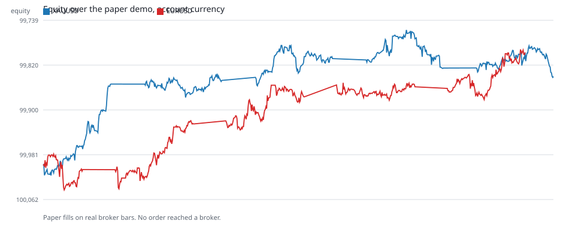
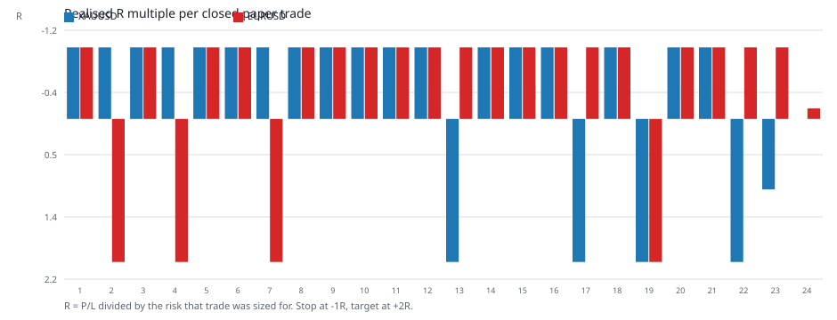
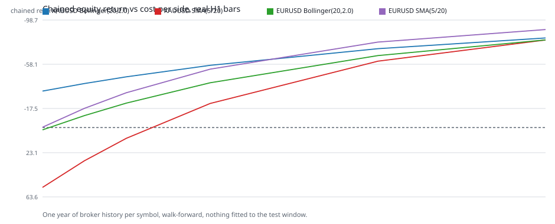
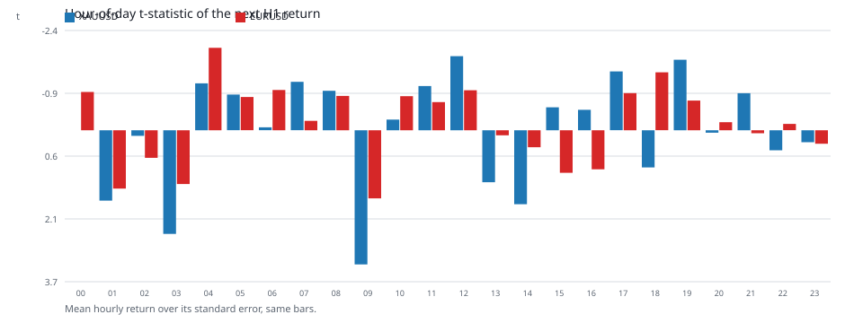

# Demo run results on real data

Russian is the base version. English: this file · Tiếng Việt: [DEMO_RESULTS.vi.md](DEMO_RESULTS.vi.md).

The run was made on 2026-11-01 on the host with MetaTrader 5 installed (build 6296), demo account
`114929502` on `MetaQuotes-Demo`, account currency USD, starting equity 100,000. The bars are the
broker's own real H1 bars, downloaded from the terminal through `copy_rates_range`; no step of this
run contained a trading call, and every journal record carries `broker_order_sent: false`.

## What was executed

```powershell
PYTHONPATH=src python scripts/run_mt5_agent.py run `
  --policy agent_data/demo_eurusd_real.yaml --source live --live-bars 600 `
  --balance 100000 --currency USD --db agent_data/demo_eurusd.db --language en --execution auto --verbose
PYTHONPATH=src python scripts/run_mt5_agent.py run `
  --policy agent_data/demo_xauusd_real.yaml --source live --live-bars 600 `
  --balance 100000 --currency USD --db agent_data/demo_xauusd.db --language en --execution auto --verbose
```

The policies live in `agent_data/` (not part of the repository): `risk_per_trade_fraction: 0.0002`,
`min_risk_reward: 1.5`, `max_open_positions: 1`, `execution_mode: auto`, `require_demo: true`, plus
pinned `expected_login` / `expected_server`. Instrument specs were read from the terminal: EURUSD —
point 0.00001, tick value 1.0, volume 0.01/0.01/500; XAUUSD — point 0.01, tick value 0.1, volume
0.01/0.01/100.

## Run outcome

| Instrument | Cycles | Closed trades | Wins | Win rate | Realized P/L | Equity | Min / max equity | Journal chain |
|---|---|---|---|---|---|---|---|---|
| XAUUSD | 540 | 23 | 5 | 0.217 | −159.96 | 100,000 → 99,840.04 | 99,756.24 / 100,018.21 | `valid: true`, 1104 events |
| EURUSD | 540 | 24 | 4 | 0.167 | −203.39 | 100,000 → 99,796.61 | 99,791.41 / 100,044.31 | `valid: true` |

No cycle sent an order to the broker; 501 (XAUUSD) and 475 (EURUSD) cycles were blocked by the
single-open-position cap, 11 and 19 by the absence of a signal, 5 and 22 by the trading window.





## Why the result looks like this

The stop is 2 × ATR and the target is 2R. For a driftless walk the probability of reaching +2R
before −1R is exactly 1/3, and the expectancy before costs is zero. The observed win rates (0.217
and 0.167) are **below** that threshold, which is why a per-trade loss appeared even at a tiny risk:
−6.95 USD per trade on gold and −8.47 USD on EURUSD.

A separate measurement over a year of the same broker bars confirms it: the lag-1 autocorrelation of
hourly returns is negative (XAUUSD −0.019, EURUSD −0.0067), so after a run of rising bars the next
bar tends to retrace, while SMA(5/20) enters exactly when the fast average is already above the slow
one. With 23 and 24 trades these results do not statistically prove the strategy loses
(t = −1.57 and −1.95), but they leave no basis for calling it profitable.

## Edge research on real bars

`scripts/render_demo_evidence.py` recomputes both strategy families on the same genuine bars, never
fitting parameters to the tested window, and repeats the sweep at several costs per side:



| Instrument | Cost per side | Bollinger(20, 2.0) | SMA(5/20) |
|---|---|---|---|
| XAUUSD | 0 bps | −33.5% (219 trades) | +54.9% (344) |
| XAUUSD | 5 bps | −46.6% | +9.9% |
| XAUUSD | 20 bps | −72.4% | −60.9% |
| EURUSD | 0 bps | +2.1% (275 trades) | −0.3% (382) |
| EURUSD | 5 bps | −22.4% | −32.0% |
| EURUSD | 20 bps | −66.1% | −78.4% |

Zero cost is a physically impossible case, not an upper bound: it shows that neither family has any
margin of safety. The one measured signal is the hour-of-day profile:



Gold gives t = +3.25 at 09 UTC and +2.51 at 03 UTC over 5742 observations; on EURUSD the largest
positive hour is +1.65 while the most extreme hour is negative, t = −2.00 at 04 UTC.
This is a hypothesis, not an edge: after correcting for 24 comparisons only borderline significance
survives on the gold hour, and it has to be tested on a separate period.

## Cross-check against the parallel workspace

`C:\Users\Administrator\.zcode\workspace\default` contains independent work on the same idea using
public Binance candles (not MT5): a 12-fold walk-forward, 32 gold strategy configurations, and
"live" virtual runs. Its conclusions match ours: trend families are negative, in-sample winners
collapse out-of-sample (PF 1.4 → 0.48), gold is mean-reverting (their lag-1 −0.015 against our
−0.019 on broker bars), and the single family that survived there — Bollinger(20, 2.0) on EURUSDT at
+7.1% — **does not reproduce** on the broker's real bars (−22.4% already at 5 bps per side). Their
"live" outcome balances: 1000 → 1004, 1000 → 996, 996.70, 998.33, +0.08, −0.57.

## The transport is alive, the market is closed: state as of 2026-11-01

The main change of the day: the path "runner → bridge → EA" works, and this is measured, not
assumed. The EA `CriticalConsensusEA_Demo` on the XAUUSD,H1 chart polls the bridge every 3 s;
arming the durable stop through `POST /v1/risk/kill-switch` produced in `MQL5/Logs/20261101.log`
exactly the lines an authenticated `GET` must produce (`BLOCKED: kill switch is active or state
is invalid.` on the poll cadence), and releasing it with `--release-kill-switch` stopped them.
Before the token was pasted into the chart inputs the same log gave `HTTP 401` on every tick. The
method and the three false conclusions it rules out are described in [MT5_AGENT.md](MT5_AGENT.md).

What does not execute despite that — and why:

| Run | Command | State |
|---|---|---|
| MT5 demo runner | `python scripts/run_mt5_demo_trading.py --policy agent_data/live_gold_ema_policy.yaml --db agent_data/demo_live_20261101.db --symbols XAUUSD,XAGUSD,EURUSD,GBPUSD,BTCUSD --cycles 0 --interval-seconds 20 --execution auto` | that process's journal stops at 1386 `agent_cycle` records, at 14:27:34 UTC, all `OUTSIDE_TRADING_WINDOW` (feed frozen since Friday 23:59 and the policy blocks Sunday), `broker_order_sent: false`, equity 100,000 unchanged, chain valid; the served-command file `agent_data/demo_bridge/served.jsonl` does not exist — the queue never served anything |
| Multi-venue paper run | `python standalone/scripts/live_multi_venue.py --interval-sec 60` | Bybit, OKX and Kraken, 6 slots (BTC and ETH on each), EMA 50/200 + a 2×ATR stop + a 2R target, 0.5% of 10,000. 6 positions open (BTC 77,838.70–77,949.50; ETH 2,264.11–2,267.07), 0 closed, the bankroll stays 10,000.00: a 2×ATR stop is wider than what the observed window allowed |
| Live portfolio | `python standalone/live_portfolio.py --minutes 0 --interval-sec 30 --balance 10000` | 5 slots, `evidence` mode, 2 open positions (gold SELL from 3,898.90, EUR SELL), 0 closed, equity 9,996.17 at 14:45 UTC |

The numbers in that table are a snapshot, not an invariant. The journal in the first row is stopped
because the process that wrote it no longer holds the bridge: port `127.0.0.1:8000` is now
held by a different runner on the same policy and the same tombstone path — hence the same `run_id` —
and that one writes to `agent_data/demo_live_mine.db`. A live run adds 12 `agent_cycle` rows a minute
(4 instruments × 3 cycles), so such a figure only means anything together with its timestamp.

Two honest caveats after the table. The first run goes on account 114929502 (100,000 USD) — so
"why is nothing opening" is no longer a sizing question, only a closed market plus a blocked
weekday. The last two runs are **paper** trades on real public crypto-exchange prices: they do not
go through MT5, do not go through the agent's gates and prove nothing about broker execution; they
prove only that the rule can keep up with a live series. `agent_data/multi_venue.jsonl` was written
during the day by three different launches (it has no single-instance guard): 3 × 6 = 18 `OPEN` lines
and no `CLOSE` line, so "18 opens" is an aggregate over sessions and not one process's history, while
the "6 open, 0 closed" counters in the ticks are the current process's state.

## The order reached the broker: state as of 2026-11-02 00:41 UTC

The market opened at 00:00 UTC and the sentence closing the previous section — "only a deal with
magic `8172026` and a `CC:` comment still awaits broker-side confirmation" — is settled: such deals
exist. Below is what actually happened, including how the agent's own accounting failed.

Permanent traces that did not exist before: `agent_data/demo_bridge/served.jsonl` exists for the
first time (2 lines, 00:00:10 and 00:07:37 UTC — exactly one per instrument command), and
`kill_switch.json` now reads `kill_switch_active: false` after the operator released the stop at
00:07:05 UTC. The 2026-11-01 table row "`served.jsonl` does not exist — the queue served nothing"
is withdrawn by this section.

Two commands executed, both accepted by the broker (`retcode=10009` in `MQL5/Logs/20261102.log`):

| Instrument | Command | Agent's expectation | Broker's deal | Time (UTC) | Outcome |
|---|---|---|---|---|---|
| EURUSD | `0e83540c…` SELL 0.06 (`cc-3f62effe965d7ad5111db40b5070`, run `demo-94c9fe799215`) | entry 1.11564, SL 1.1187071, TP 1.1095057, risk 18.40 USD | deal `10934940848`, price 1.11563, position `11185843968` | 00:00:09 | agent journalled `UNCONFIRMED` / `NO_FILL_OBSERVED`; the position was closed outside the EA at 00:07:14 (deal `10935020451`, magic 0, empty comment) for −1.56 USD |
| XAUUSD | `f62fcc82…` SELL 0.04 (`cc-63dee1b6fd2debd42ec87d81540e`, run `demo-93b10275ab25`) | entry 3902.18, SL 3947.0657, TP 3812.4086, risk 17.95 USD | deal `10935023434`, price 3902.27, position `11185923231` | 00:07:36 | `FILLED`, `broker_order_sent: true`; the position is still open, with SL/TP held by the broker |

Times are UTC after subtracting `server_utc_offset_seconds: 7200` from the terminal's stamps
(`src/critical_consensus/mt5_agent/backend.py:425-442`): the raw stamp of the first deal is
`2026-11-02T02:00:09`, which reconciles with `served.jsonl` (00:00:10) and the EA line at
`07:00:10.556` local (UTC+7).

Why the first command was never confirmed by the agent itself — and it was not the market:
`entry_deals()` in `scripts/run_mt5_demo_trading.py:557-570` read history through a "−1 hour /
+1 hour" window until 00:06:25 UTC (working-tree diff: `timedelta(hours=1)` → `days=7` / `days=3`),
while the MetaQuotes-Demo server runs at UTC+2 and the terminal clips the range at its right edge:
measured on the live terminal at 04:58:51 UTC with the left edge fixed at −7 days, now+4h returned
1 row and neither magic-`8172026` deal, now+8h returned 5 rows and both fills. A clipped range reads as an empty book, so an order the
broker really filled became `NO_FILL_OBSERVED`, the run stopped on its own guard
(`kill_switch_reason: "EURUSD:UNCONFIRMED"`), and the restarts (rc=3, six attempts from 00:00:58 to
00:07:04) were refused by that same unresolved outcome. The fix is in the working tree and
**uncommitted**; the gold run started at 00:06:33 already carrying it, which is why the second
command is journalled correctly. No execution gate was bypassed here: the kill switch was released
by the operator through `--release-kill-switch` at 00:07:05 UTC (`kill_switch.json` records
`actor_id: Administrator`, `kill_switch_active: false`), and the gold restart passed
`--acknowledge-uncertain`, i.e. the operator explicitly accepted the unresolved EURUSD outcome.

What the journals show (a snapshot at 00:41 UTC, not an invariant):

| Journal | `agent_cycle` per instrument | `demo_order_command` | `demo_order_served` | `demo_order_outcome` | `demo_symbol_alias` | `demo_symbol_unavailable` | `demo_risk_baseline` |
|---|---|---|---|---|---|---|---|
| `agent_data/demo_live_all_universe.db` (4523 cycles) | EURUSD 647, GBPUSD/AUDUSD/NZDUSD/XAUUSD/XAGUSD/US500 646 each | 1 | 1 | 1 (`UNCONFIRMED`) | 0 | 18 (6 instruments × 3 starts) | 2 |
| `agent_data/demo_gold_live.db` (104 cycles at 00:40:59 UTC) | XAUUSD 104 | 1 | 1 | 1 (`FILLED`) | 0 | 0 | 23 |

Blockers. In the all-universe journal, 646 of EURUSD's 647 cycles and exactly 646 cycles of each of
the other six instruments are `OUTSIDE_TRADING_WINDOW`; the single unblocked cycle is `OBSERVED` at
00:00:07 (the window in `config/forward/06_ema_all_universe_h1.yaml:54-56` opens at 00:00 UTC,
Sunday is blocked). The six instruments produced no signal not because their window is shut but
because the round ended at the first symbol: the runner is stopped, and since 00:07:06 UTC its
supervisor stands aside — "port 8000 held by foreign pid=12464; standing down, not killing"
(`agent_data/supervisor_all_universe.log`), where pid 12464 is the gold run's bridge. The gold run,
by contrast, is trading and is now blocked by its own limits rather than by the window: 100 cycles
`POSITION_CAP_REACHED,SYMBOL_ALREADY_OPEN`, 3 `POSITION_CAP_REACHED`, 1 `OBSERVED` (that counter grows
by 3 cycles a minute, so it is a snapshot too).

EA gates. `MQL5/Logs/20261102.log` (UTF-16LE, 142 lines, local UTC+7 stamps) splits into five
intervals, none of them an execution refusal: 06:20:23–07:00:10 and 07:00:44–07:06:35 — 129 ×
`BLOCKED: kill-switch state unavailable; HTTP 1001, error=5203`, where the EA could not read the
stop's state, so the cycle never reached a command; 07:00:10.556 — `Order accepted` for
`command_id=0e83540c…`, `deal=10934940848`, `retcode=10009`; 07:06:35–07:07:04 — 11 × `BLOCKED:
kill switch is active or state is invalid.` (the armed `EURUSD:UNCONFIRMED` stop); 07:07:37.560 —
`Order accepted` for `command_id=f62fcc82…`, `deal=10935023434`, 32 s after the release. There is no
line anywhere about a slippage guard, stops level, volume constraints, invalid geometry or
`SymbolSelect failed`: as of 00:41 UTC no command reached the EA and was rejected by an EA gate.
`demo_symbol_alias` events are zero in both journals — the broker-spelling reconciliation was never
needed, both commands went out under the name the agent produced itself.

Answering "how many instruments actually trade": one — XAUUSD. Account 114929502 (MetaQuotes-Demo,
demo) at 00:43:45 UTC: balance 99,998.44, equity 100,026.12, `open_positions: 1`, position
`11185923231` SELL 0.04 from 3902.27 with stop 3947.07 and target 3812.41, floating +27.68 USD,
comment `CC:cc-63dee1b6fd2debd42`. The other six all-universe instruments do not trade: their runner
is halted by its own unresolved-outcome guard, and that unresolved outcome, as shown above, was a
deal-history read defect, not a broker rejection and not a missing signal.

## The first two fills: where the risk model was wrong (measured at 01:59 UTC)

By 02:00 UTC the account carries two realized deals and one open position — and both deals were
closed NOT by the EA:

| Time (UTC) | Deal | What | USD |
|---|---|---|---|
| 00:07:14 | `10935020451` | EURUSD BUY OUT 0.06 at 1.11589, magic 0, empty comment | −1.56 |
| 01:21:53 | `10935754921` | XAUUSD BUY OUT 0.03 at 3910.57, magic 0 (partial close of position `11185923231`) | −24.90 |
| now | position `11185923231` | XAUUSD SHORT 0.01 from 3902.27, SL 3947.07, TP 3812.41, comment stripped by the broker after the partial close | floating ≈ −6.75 |

Balance 99,973.54, equity ≈ 99,967. Realized −26.46 USD is already past the 20 USD daily budget,
while neither the kill switch nor the budget gate fired. The reason is measured, not guessed:
**the risk model understates the metals by exactly 10×.**

Price of the question, empirically. Closing 0.03 lots of gold 8.30 above the open price lost 24.90,
i.e. 24.90 / 8.30 / 0.03 = 100.00 $ per $1 of price move per lot; an independent reading of the live
position agrees: −6.75 / (ask 3909.02 − 3902.27) / 0.01 = 100.00. The broker's own
`trade_contract_size` for XAUUSD is 100.0, which matches. But `trade_tick_value / trade_tick_size`
= 0.1 / 0.01 = 10.0 — the terminal reports a tick value ten times below its own contract size and
below the realized P&L. The gold command in the journal reads `final_risk_value` 17.9542 =
0.04 × 44.8857 × 10, i.e. the sizing used that understated figure. The real exposure to the stop at
3947.07 was 0.04 × 44.886 × 100 = **179.54 USD**, not 17.95.

Checked across all seven instruments (read-only, `symbol_info`):

| Instrument | $/lot/$1 from tick_value | $/lot/$1 from contract_size | Verdict |
|---|---|---|---|
| EURUSD, GBPUSD, AUDUSD, NZDUSD | 100,000 | 100,000 | consistent |
| US500 | 1.00 | 1.0 | consistent |
| XAUUSD | 10.00 | 100.0 | **understated 10×** |
| XAGUSD | 500.00 | 5000.0 | **understated 10×** |

The note in `config/forward/06_ema_all_universe_h1.yaml:26-29` ("pays 100 $ per price unit per lot,
which is the contract size and not this field; a live run sizes from the terminal regardless") names
the correct value but does not save the run: in this pair of fields the terminal contradicts itself,
and the run took the wrong one. FX was untouched — EURUSD's `final_risk_value` 18.40 reconciles with
the realized −1.56 (a 0.00026 move on 6,000 units) to the cent.

Link state at 01:58 UTC: the gold run is dead (its runner is gone, the journal fell silent at
01:39:24.730 — 279 cycles, 1 signal, 25 `demo_risk_baseline`); the supervisor brought the
all-universe runner back at 01:40:50 (pid 10928, run_id `demo-8199be303a70`, once port 8000 was free),
and now all seven instruments are blocked by `POSITION_CAP_REACHED` — the 0.01 XAUUSD remnant holds
the single slot, and XAUUSD additionally `SYMBOL_ALREADY_OPEN`. Not one signal has appeared since the
restart, so the count of instruments actually trading is zero: the agent has a position, it has no new
execution.

## The risk price is fixed and the transport died a second time (measured 04:47–04:51 UTC)

Sizing now runs off `contract_size` (`SymbolSpec.cash_per_price_unit` prefers the contract and the
`tick_value/tick_size` ratio is only a fallback), and that was checked against the live terminal
rather than a fixture: `from_terminal` returns 100 000.0 for EURUSD/GBPUSD/AUDUSD/NZDUSD
(divergence from the tick pair ~0), 1.0 for US500 (0.0), 100.0 against 10.0 for XAUUSD
(divergence 0.9) and 5000.0 against 500.0 for XAGUSD (0.9). Replaying `size_position` offline at
the corrected price: at a 0.0002 fraction gold is refused with
`MINIMUM_LOT_EXCEEDS_RISK_BUDGET` (the tick-priced calculation would have sent 0.04 lots as
"18.0 $"), at 0.0005 it is 0.01 lot and 44.9 $; silver only passes with a stop of ~1.0 or less.

The universe runner did trade on the corrected price and queued real commands: 02:22:59–02:36:46
UTC — EURUSD SELL 0.16 (48.34 $ of risk), GBPUSD BUY 0.18 (49.53 $), XAGUSD SELL 0.01 (46.09 $).
`agent_data/demo_live_all_universe.db` at 04:47 UTC: 14 `demo_order_command`, 26
`demo_order_outcome`, **1** `demo_order_served`. The 26 outcomes decompose exactly: 13
`COMMAND_EXPIRED` (every new command, `broker_order_sent: false`), 12 `VOLUME_ABOVE_DEMO_CAP`
(AUDUSD, NZDUSD and US500 four rounds each — the proposed volume is above the 0.20-lot demo ceiling)
and one `NO_FILL_OBSERVED` at 00:00:40 for the single 00:00:07 command.
`served.jsonl` has not grown since 00:07:37.
The broker took none of the commands built on the correct price, and the reason is named by the
advisor's log rather than guessed.

What happened next: the terminal was restarted with `/config` at 03:51:44 UTC,
`CriticalConsensusEA_Demo (XAUUSD,H1)` initialized at 03:51:45 with a valid token and then logged
`HTTP -1, error=4014` on **356 consecutive polls** until 04:11:03, after which it wrote nothing.
Throughout that the bridge was listening on `127.0.0.1:8000` inside the runner's own process, so the
block was the terminal's own `WebRequest` permission — not the network and not the token. The
universe runner had died earlier, at 03:09:36, its last cycles `BLOCKED ['ACCOUNT_READ_FAILED']`
across all seven instruments. Since 00:07:36 UTC there has not been one fill: the number of
instruments actually trading is **zero**.

The observation tooling gets its own paragraph because it is what hid this for hours:
`scripts/system_status.ps1` read the advisor's log by the literal name `20261101.log`, i.e.
**yesterday's**, so it showed the operator a clean tail while today's 356 polls were refusals, and
`scripts/system_start.ps1` wrote its journal to `demo_live_20261101.db` with the date frozen in the
name, so every later day appended to the previous day's audit trail and re-read that day's risk
budget. Both are fixed, the transport state is now a command — `scripts/check_ea_transport.py`
(0 healthy, 1 broken, 2 no log) — and a test pins that all 43 refusal strings the advisor can print
map to a named state.

State at 04:51 UTC: the gold journal holds 942 rows / 457 cycles, its last line timestamped
`2026-11-02T04:51:19.899`, and the last 300 cycles are 100 %
`['POSITION_CAP_REACHED', 'SYMBOL_ALREADY_OPEN']` (the remnant occupies the only slot under
`max_open_positions: 1`), and the whole session has 1 command / 1 served / 1 outcome; account
114929502, balance 99 973.54, equity 99 975.18, free margin 99 936.16 (measured 04:47:52); position XAUUSD SHORT 0.01
from 3902.27 (SL 3947.07, TP 3812.41) at **+1.64** floating — 1.64 $ for 1.64 points on 0.01 lot is
100 $ per lot per dollar again; the kill switch has been released since 00:07:05.295; deals with
magic `8172026` and a `CC:` comment are still exactly two, realized −26.46.

State at 05:31–05:35 UTC, the next reading of the same day, and it changes the verdict. The advisor is
back on the bridge — `error=4014` is gone, replaced by `HTTP 1001, error=5203` across 639 consecutive
BLOCKED lines, the newest at 12:33:22 on the machine clock (= 05:33:22 UTC), and `check_ea_transport.py`
on that state prints `bridge_unreachable` and exits 1. There is nothing to talk to: `Get-NetTCPConnection
-LocalPort 8000 -State Listen` returns nothing, `Win32_Process` holds no `run_mt5_demo_trading.py`, the
gold journal is stopped at seq 1096 (`2026-11-02T05:17:01.263800+00:00`) and its `.err` carries only the
three-line banner. The bridge cannot be raised from this session: `MT5_BRIDGE_TOKEN` and
`MT5_KILL_SWITCH_ADMIN_TOKEN` are absent at Process, User and Machine scope (compared by length only, the
values were never printed), and a fresh token would buy nothing but `token_rejected`. So the terminal
permission that was the operator's outstanding act all day has in fact been granted, and the single thing
now between the queue and the broker is a running runner.

## What was actually "falling over" in the logs (read 05:05–05:25 UTC)

The word "crash" covers four different things in this journal, and only one of them is code.

**Six `rc=3`, 00:01:58–00:07:04 UTC, exactly 60 s apart.** Each one carries the same line: `В журнале
моста есть отданные команды без подтверждённой сделки: cc-3f62effe965d7ad5111db40b5070`. That is not a
fault, it is an honest refusal to start: the command was served at 00:00:40, its fill was journalled
`NO_FILL_OBSERVED`, and a new process may not begin on top of an order it cannot account for. The cause
is the read, not the broker — that deal **is** in the account history, its comment being `CC:` plus the
first twenty characters of the same id, so the broker took the order and only the windowed read missed
it.

**A deliberate hour-and-twenty pause, 00:07:06–01:28:33 UTC.** Six lines of `port 8000 held by foreign
pid=12464; standing down, not killing` — the supervisor stepped away from someone else's process on the
port, as instructed. That is a pause by rule, not a fall.

**Two external terminations.** `rc=4294967295` = `-1` for pid 10928 at 02:22:57, and `rc=3221225786` =
`0xC000013A` (a console interrupt) for pid 14392 at 2026-11-01T23:20:55. The runner log contains **no
traceback from `run_mt5_demo_trading.py` at any point**, so neither process died on a Python exception;
both were removed from outside, and the supervisor restarted them within the same second. The
supervisor's own last line is `03:09:23Z heartbeat journal_rows=11116` — it stopped writing, which is
why the runner has been silent since 03:09:36. Between 02:22:59 and 02:36:46 that runner still queued 13
commands, and all 13 expired on TTL (`COMMAND_EXPIRED`) because the advisor could not reach the bridge in
those minutes. The last half hour before the silence is a different mode again: from seq 10503
(`02:37:47 UTC`) to the end, all 600 most recent `agent_cycle` rows carry the single blocker
`ACCOUNT_READ_FAILED` — the process kept cycling while being unable to read the account. The same blocker
had already appeared from 02:20:05 to 02:22:57, exactly around the external `rc=-1`.

**Six bridge tracebacks — the one thing that genuinely needed fixing.** `Exception occurred during
processing of request from ('127.0.0.1', 5075x)` with `ConnectionAbortedError: [WinError 10053]` looks
like a bridge going down and was an ordinary disconnect: the terminal abandons its own `WebRequest` the
moment it refuses the poll, the loopback socket dies mid-answer, and `socketserver` printed a full
traceback for each one — 57 lines for three aborts — while the lines around them were normal command
lifecycles and the queue kept serving. `scripts/mt5_demo_bridge.py` now overrides `handle_error`: the
three expected disconnects (`ConnectionAbortedError`, `ConnectionResetError`, `BrokenPipeError`) cost
**one** line, every other exception still gets the full report. Measured on a throwaway bridge on an
ephemeral port (not `:8000`, which belongs to the other agent): three forced resets gave **57 stderr
lines with tracebacks** without the filter and **3 lines, no traceback** with it, and in both cases the
same bridge answered a later `GET /v1/risk/kill-switch` with 200. Pinned by 4 new cases in
`tests/test_mt5_demo_bridge.py`.

**And a fifth thing that is not in those logs at all: as of 05:31–05:33 UTC the runner itself is gone.**
`Get-NetTCPConnection -LocalPort 8000 -State Listen` returns nothing and `Win32_Process` contains no
`run_mt5_demo_trading.py`; the gold journal stops at seq 1096, `2026-11-02T05:17:01.263800+00:00`, and its
`.err` holds only the three-line startup banner. There is no traceback to look for here — the process did
not crash, it is not running. The advisor meanwhile polls again and gets `HTTP 1001, error=5203`, which
means the terminal's permission gate has since been opened, and the only remaining external act is to
start the runner with a token that is presently absent from Process, User and Machine scope (measured by
length only, never printed).

## A third fill at the broker: state 05:43–06:10 UTC

`scripts/system_start.ps1` was launched at 05:43:12 UTC, and from that second the queue reaches the
broker again. `agent_data/demo_live_20261102.db` holds **657 events / 324 cycles** from `05:43:13.106`
to `06:10:16.472`, and exactly one of those cycles is clean: command
`b3d8fc393ea14b1b836da9e91fb9f8ac` / `cc-1bac6713ce6d749fe849117770c4` queued 05:43:13.368
(`SELL EURUSD`, expected 1.11823, `decision: AUTO`), served 05:43:15.374, outcome 05:43:32.402 —
`state: FILLED`, `broker_order_sent: true`, `requires_manual_reconciliation: false`. Broker-side the same
order is deal **10938325361**, position **11189096387**, EURUSD SELL 0.09 @ 1.11823, SL 1.12042,
TP 1.11385, magic `8172026`, comment `CC:cc-1bac6713ce6d749fe`. So the widened `entry_deals()` window
resolved a fill in production twelve hours after the same code reported `NO_FILL_OBSERVED` for a command
on the same account. The command's own gates read `final_risk_value` 19.7229 at
`final_risk_fraction` 0.000197 (budget 0.0002), `risk_reward_at_fill` 2.0, `slippage` 0.0,
`final_margin_required` 100.6407.

The other 323 cycles block behind that position: **241 `POSITION_CAP_REACHED`, 80
`POSITION_CAP_REACHED + SYMBOL_ALREADY_OPEN`, 2 `MINIMUM_LOT_EXCEEDS_RISK_BUDGET`, 1 clean**.
`max_open_positions: 1` counts the whole account, not the symbol, so one filled order stops every
instrument in the set; the two minimum-lot cycles are instruments whose smallest tradable lot already
risks more than 20 USD. Account at 06:10:18 UTC: balance 99 968.87, equity 99 966.62, the open position
at −2.25 floating.

The realized side of the same read corrects a figure this document carried. `history_deals_get` over
−2 days / +3 days returns **7** deals: the three entries above carry magic `8172026` and a `CC:` comment,
and **every closing deal arrives with magic 0 and an empty comment** — they are not commands of this
chain and no journal line claims them. Their profits are −1.56, −24.90 and −4.67, together **−31.13**,
and 100 000 − 31.13 equals the balance the broker reports, so nothing is missing from the read. The
earlier "−26.46" was measured before the last 0.01 XAUUSD closed at 05:17:11 UTC.

## The transport was not dead: why `check_ea_transport.py` cried BROKEN, and what it measures now

The same status line printed `ea_silent (BROKEN)` over a chain that had filled an order two seconds
earlier. The cause is the advisor itself: **it writes nothing while everything is fine**. Measured across
the three `MQL5\logs\*.log` files, the whole corpus is **4904 lines — 4875 `BLOCKED`, 10 initialization
lines, 8 `automated trading is disabled`, 6 enabled, 3 `Order accepted`, 2 `PROBE`**; there is no
healthy-poll line in the source at all, so silence in the log cannot separate a live poll loop from an EA
detached from the chart, and the checker had been inferring exactly that.

The bridge is now the witness. `BridgeState` counts and timestamps every **authenticated** GET on the two
endpoints only the advisor polls (`/v1/risk/kill-switch`, `/v1/execution/next`; refused requests, POSTs,
an `Origin` header and the health read itself are not counted, each pinned by a test), and a new
token-guarded `GET /v1/health` answers with those counters and the poll age measured on the bridge's own
clock. The checker asks it **only** when its verdict rests on silence (`ea_silent`, `never_polled`), so a
named refusal in the log is never papered over by a counter from elsewhere. Measured against the real log
directory with a current-build bridge on an ephemeral port (not `:8000`): `--no-bridge` gives
`ea_silent (BROKEN)` and exit **1**, the same read with the bridge gives `polling (healthy)` and exit **0**
with `bridge: advisor polled 0.1 s ago, 2 polls total`; an unauthenticated `/v1/health` answers **401**; a
stale poll (900 s) keeps `ea_silent` and says the silence is real; and `unreachable`, `http_401`,
`http_404`, `not_json` and a malformed URL each answer with a reason instead of raising. That the port is
polled right now is visible without any of the new code: the loopback socket table over
06:05:06–06:06:36 UTC held **80 connections in TIME_WAIT with 80 distinct peer ports, sliding from
62520–62673 to 62631–62789**, about 57 freshly closed connections every 45 s.

One honest remainder: the runner on `:8000` started at 05:43:12, before this change existed, so its bridge
has no `/v1/health` and the checker says so in words — `the bridge has no /v1/health: it is running an
older build than this checker` — and leaves the log verdict alone. Restarting `run_mt5_demo_trading.py`
would make the live verdict correct; it was not done here, because stopping the process that is currently
trading is the operator's call, and the position's SL/TP live on the broker either way.

## What this run proves and what it does not

Proven: the chain "real broker bars → policy gates → sizing → execution through the EA → hash-linked
journal" reached a real broker order and back. Deal `10935023434`, magic `8172026`, comment
`CC:cc-63dee1b6fd2debd42` is readable in account 114929502's own history independently of the agent's
journal. Of the two commands, the risk claim holds only for EURUSD: its `final_risk_value` 18.40
reconciles with the realized −1.56 to the cent. For XAUUSD the earlier wording "risk 17.95 USD against
a 20 USD budget" is **withdrawn** — the true exposure to the stop was 179.54 USD, and the realized
−26.46 USD is by itself already past the 20 USD daily budget (see the section above). The 2026-11-01
statement "no order reached a broker" applied to the paper runs of 2026-10-31 and 2026-11-01 and still
holds only for those.

Not proven: anything statistical. Three commands is n=3, and none of the three reached its stop or its
target. The first two were closed outside the EA — the first in full (deal `10935020451`, 0.06, −1.56
USD), the second in part (deal `10935754921`, 0.03 of 0.04, −24.90 USD), with the 0.01 remainder closed
by deal `10937991911` at 05:17:11 UTC for −4.67 USD — and the third is still open, measured at **−2.25**
floating at 06:10:18 UTC. Every outgoing deal carries magic 0 and an empty comment, and these data do not
establish who made them. The account's realized total is −31.13 USD, which is already three times the
20 USD per-cycle risk budget (`risk_per_trade_fraction` 0.0002), even though each individual entry stayed
inside it: the losses did not come from a gate being violated but from closes happening outside the
chain, where its gates do not reach. So this tests the EMA 50/200 edge on H1 in no direction at all.

The second thing not proven is that the chain runs **sustainably**. The two fills happened inside the
first seven minutes after the open; the all-universe runner has been silent since 03:09:36 UTC (5867
cycles, 14 commands, 26 outcomes: 13 `COMMAND_EXPIRED`, 12 `VOLUME_ABOVE_DEMO_CAP`, 1
`NO_FILL_OBSERVED`); the gold runner is alive and journalling (448 cycles, last 04:48:19.725) but its
last 300 cycles are all `POSITION_CAP_REACHED, SYMBOL_ALREADY_OPEN`; and the advisor is not polling at
all — `check_ea_transport.py` reports `ea_silent` with `stale_from: request_not_allowed` after 356
consecutive refusals, its last line being `HTTP -1, error=4014` at 04:11:03 UTC. Re-read at 05:31–05:33
UTC the picture had moved on its own: the advisor polls again — 477 `HTTP 1001, error=5203` lines across
the log, latest 05:33:22 UTC — because the terminal's permission gate is now open, and what it reaches is
an empty port: `Get-NetTCPConnection -LocalPort 8000 -State Listen` returns nothing and `Win32_Process`
holds no `run_mt5_demo_trading.py` at all (the gold journal stops at seq 1096,
`2026-11-02T05:17:01.263800+00:00`). So at that reading the instruments that could execute were still
zero, and the separating gate was no longer the GUI: the runner simply was not running, and it could not be
started from this session because `MT5_BRIDGE_TOKEN` was absent at Process, User and Machine scope (checked
by length only, never printed) — a fresh token would only produce `token_rejected`. That reading held until
05:43:12 UTC and is superseded by the section above: the runner is up, and a command was served and filled.
Sustained operation is still the next question to measure, not a state already reached — and after
05:43:15 the queue itself was never exercised again, because all 321 following cycles were stopped by the
occupied slot. What separates a further entry right now is `max_open_positions: 1`, not the transport.

One PENDING EXTERNAL remains, and it is no longer about the agent seeing its own entry: the widened window
did that in production at 05:43:15, where deal `10938325361` was read and the command closed as `FILLED`
with `requires_manual_reconciliation: false`. What is still open is what the widening cannot touch — that
the agent sees the **close** of its own position: every outgoing deal in this chain's history arrives with
magic 0 and an empty comment, and none of the three closes was matched to a command of these runs. The
historical mismatch itself stands as measured: the EURUSD deal was filled by the broker — account history
holds a deal commented `CC:cc-3f62effe965d7ad51…` — and the all-universe runner journalled
`NO_FILL_OBSERVED` for it at 00:00:40, while the gold runner's outcome for its own fill carries
`broker_order_sent: true` and the whole deal `10935023434`. The mechanism is now reproduced on the
live terminal (04:58:51 UTC, same seven-day left edge): a right edge of now+4h returns 1 row and
neither magic-`8172026` deal, now+8h returns 5 rows and both fills — so it is the right edge that
clips, because these naive bounds are read on the server clock (+7200 s), and the recorded −1h/+1h
window would have answered an empty book at 00:00:40. The uncommitted widening in `entry_deals()`
(−7 days / +3 days) is pinned by
`test_entry_deals_asks_for_a_window_wide_enough_to_see_a_server_clock_fill`.
The ordering under which the gold run (started 00:06:33) already read the wide window while the
00:00:40 check did not is described above; it is derived from the edit time and the process start
time, not from the journal itself. The claim that "the EA is not attached to a chart and
`Config/common.ini` carries no allowlist" remains **untrue and withdrawn**; the transport is now
confirmed by real `retcode=10009`, not only by log echoes.
