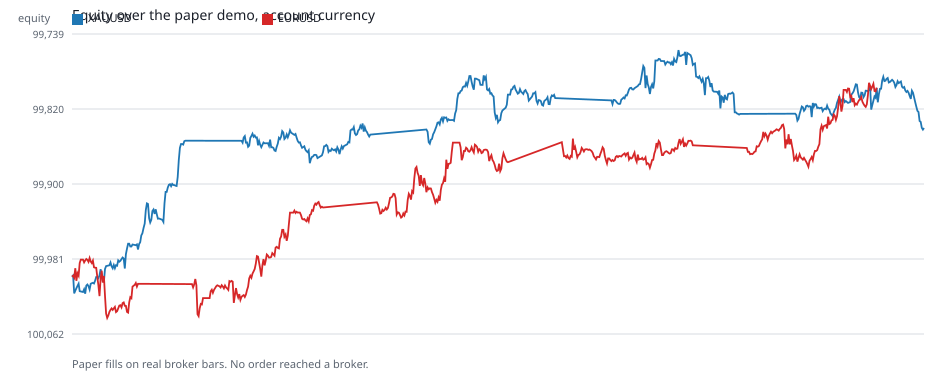
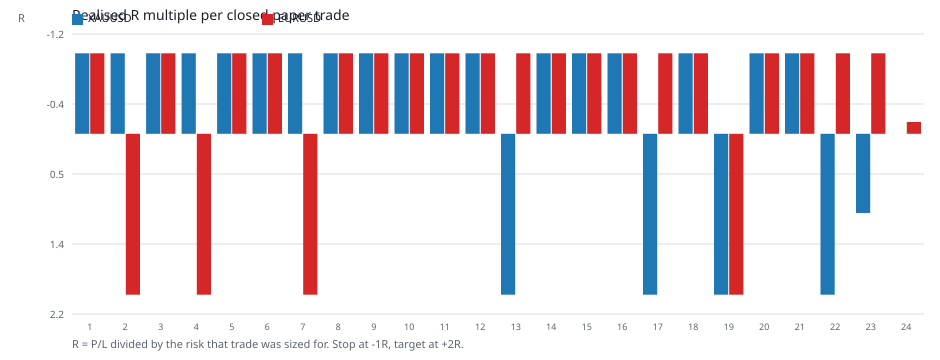
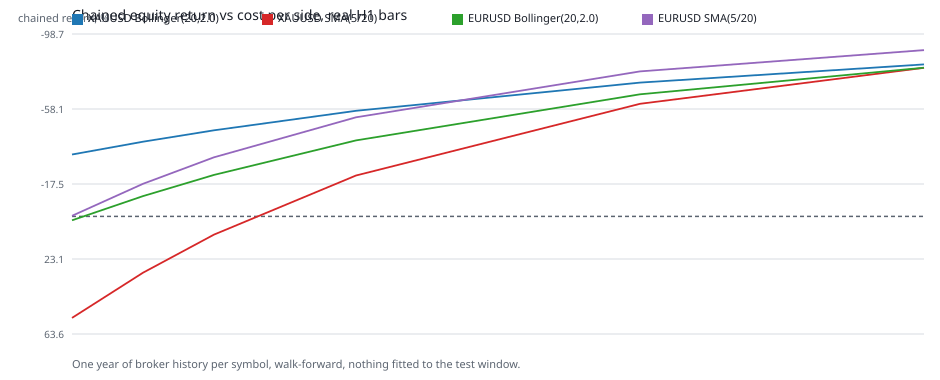
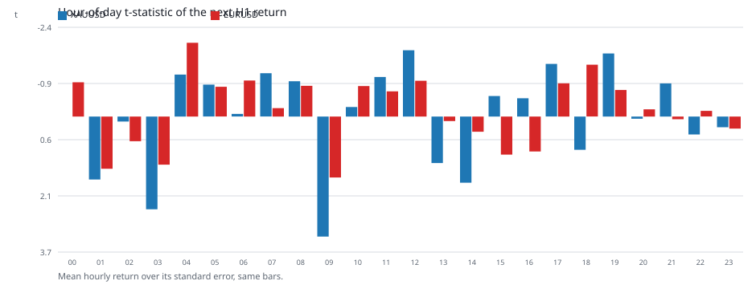

# Результаты демо-прогона на реальных данных

Русский — базовая версия. English: [DEMO_RESULTS.en.md](DEMO_RESULTS.en.md) · Tiếng Việt:
[DEMO_RESULTS.vi.md](DEMO_RESULTS.vi.md).

Прогон выполнен 2026-11-01 на хосте с установленным MetaTrader 5 (build 6296), демо-счёт
`114929502` на `MetaQuotes-Demo`, валюта счёта USD, стартовое равенство 100 000. Бары — настоящие
часовые бары брокера, загруженные из терминала через `copy_rates_range`; торговых вызовов в этом
прогоне не было ни на одном шаге, и каждая запись журнала несёт `broker_order_sent: false`.

## Что именно запускалось

```powershell
PYTHONPATH=src python scripts/run_mt5_agent.py run `
  --policy agent_data/demo_eurusd_real.yaml --source live --live-bars 600 `
  --balance 100000 --currency USD --db agent_data/demo_eurusd.db --language ru --execution auto --verbose
PYTHONPATH=src python scripts/run_mt5_agent.py run `
  --policy agent_data/demo_xauusd_real.yaml --source live --live-bars 600 `
  --balance 100000 --currency USD --db agent_data/demo_xauusd.db --language ru --execution auto --verbose
```

Политики лежат в `agent_data/` (не входят в репозиторий): `risk_per_trade_fraction: 0.0002`,
`min_risk_reward: 1.5`, `max_open_positions: 1`, `execution_mode: auto`, `require_demo: true` и
закреплённые `expected_login` / `expected_server`. Спецификации инструментов взяты из терминала:
EURUSD — point 0.00001, tick value 1.0, лот 0.01/0.01/500; XAUUSD — point 0.01, tick value 0.1,
лот 0.01/0.01/100.

## Итог прогона

| Инструмент | Циклов | Закрытых сделок | Выигрышей | Доля выигрышей | Реализованный P/L | Эквити | Мин / макс эквити | Цепочка журнала |
|---|---|---|---|---|---|---|---|---|
| XAUUSD | 540 | 23 | 5 | 0,217 | −159,96 | 100 000 → 99 840,04 | 99 756,24 / 100 018,21 | `valid: true`, 1104 события |
| EURUSD | 540 | 24 | 4 | 0,167 | −203,39 | 100 000 → 99 796,61 | 99 791,41 / 100 044,31 | `valid: true` |

Ни один цикл не отправил ордер брокеру; 501 (XAUUSD) и 475 (EURUSD) циклов заблокированы лимитом
одной открытой позиции, 11 и 19 — отсутствием сигнала, 5 и 22 — вне торгового окна.





## Почему именно такой результат

Стоп — 2 × ATR, тейк — 2R. Для блуждания без сноса вероятность достичь +2R раньше, чем −1R,
равна ровно 1/3, и матожидание до издержек равно нулю. Наблюдённая доля выигрышей (0,217 и 0,167)
**ниже** этого порога, поэтому убыток на сделку появился даже при малом риске: −6,95 USD на
сделку для золота и −8,47 USD для EURUSD.

Это подтверждается отдельным измерением на годовой истории тех же брокерских баров: лаг-1
автокорреляция часовых доходностей отрицательная (XAUUSD −0,019, EURUSD −0,0067), то есть после
серии растущих баров следующий склонен к откату, а SMA(5/20) входит ровно тогда, когда быстрая уже
выше медленной. Статистически эти 23 и 24 сделки не доказывают убыточность стратегии
(t = −1,57 и −1,95), но и не оставляют оснований считать её прибыльной.

## Исследование преимущества на реальных барах

`scripts/render_demo_evidence.py` пересчитывает две семьи стратегий по одним и тем же настоящим барам,
никогда не подгоняя параметры под тестируемое окно, и повторяет прогон при разных
издержках на сторону:



| Инструмент | Издержки | Bollinger(20; 2,0) | SMA(5/20) |
|---|---|---|---|
| XAUUSD | 0 б.п./сторону | −33,5% (219 сделок) | +54,9% (344) |
| XAUUSD | 5 б.п. | −46,6% | +9,9% |
| XAUUSD | 20 б.п. | −72,4% | −60,9% |
| EURUSD | 0 б.п./сторону | +2,1% (275 сделок) | −0,3% (382) |
| EURUSD | 5 б.п. | −22,4% | −32,0% |
| EURUSD | 20 б.п. | −66,1% | −78,4% |

Нулевые издержки — это физически невозможный вариант, а не «лучшая оценка»: он показывает, что у
обеих семей нет запаса прочности. Единственный измеренный сигнал — профиль по часам:



Для золота 09 UTC даёт t = +3,25 и 03 UTC t = +2,51 на 5742 наблюдениях; у EURUSD максимальный
положительный час +1,65, а самый выделенный час — отрицательный: t = −2,00 в 04 UTC. Это гипотеза, а не готовое преимущество: при 24 сравнениях поправка на множественность
оставляет от золотного часа лишь пограничную значимость, и проверять её нужно на отдельном периоде.

## Перекрёстная проверка с параллельной рабочей папкой

`C:\Users\Administrator\.zcode\workspace\default` содержит независимую работу по той же идее на
публичных свечах Binance (не MT5): 12-fold walk-forward, 32 конфигурации золотой стратегии, «живые»
виртуальные прогоны. Их выводы совпали с нашими: трендовые семьи отрицательны, in-sample победители
рассыпаются out-of-sample (PF 1,4 → 0,48), золото возвратное (их лаг-1 −0,015 против нашего −0,019
на брокерских барах), а единственная выжившая у них семья — Bollinger(20; 2,0) на EURUSDT, +7,1% —
на реальных барах брокера **не воспроизводится** (−22,4% уже при 5 б.п./сторону). Их «живые»
результирующие балансы: 1000 → 1004, 1000 → 996, 996,70, 998,33, +0,08, −0,57.

## Транспорт жив, рынок закрыт: состояние на 2026-11-01

Главное изменение дня: путь «runner → мост → советник» работает, и это измерено, а не предполагано.
Советник `CriticalConsensusEA_Demo` на графике XAUUSD,H1 опрашивает мост каждые 3 с; включение
постоянного стопа через `POST /v1/risk/kill-switch` вызвало в `MQL5/Logs/20261101.log` ровно те
строки, которые должен вызывать успешный аутентифицированный `GET` (`BLOCKED: kill switch is active or
state is invalid.` с шагом опроса), а снятие стопа через `--release-kill-switch` их остановило. До
ввода токена в поля графика тот же лог давал `HTTP 401` на каждом тике. Методика и три ложных вывода,
которые она исключает, описаны в [MT5_AGENT.md](MT5_AGENT.md).

Что при этом не исполняется — и почему:

| Прогон | Команда | Состояние |
|---|---|---|
| Демо-раннер MT5 | `python scripts/run_mt5_demo_trading.py --policy agent_data/live_gold_ema_policy.yaml --db agent_data/demo_live_20261101.db --symbols XAUUSD,XAGUSD,EURUSD,GBPUSD,BTCUSD --cycles 0 --interval-seconds 20 --execution auto` | журнал этого процесса остановлен на 1386 записях `agent_cycle` в 14:27:34 UTC, все `OUTSIDE_TRADING_WINDOW` (фид заморожен с пятницы 23:59, политика блокирует воскресенье), `broker_order_sent: false`, эквити 100 000 без изменений, цепочка корректна; файл отданных команд `agent_data/demo_bridge/served.jsonl` не существует — очередь не отдавала ничего |
| Мультивыночный бумажный прогон | `python standalone/scripts/live_multi_venue.py --interval-sec 60` | Bybit, OKX и Kraken, 6 слотов (BTC/ETH на каждой), EMA 50/200 + стоп 2×ATR + цель 2R, 0,5% от 10 000. Открыто 6 позиций (BTC 77 838,70–77 949,50; ETH 2 264,11–2 267,07), закрытых 0, банк остаётся 10 000,00: 2×ATR шире, чем уложилось в наблюдавшееся время |
| Живой портфель | `python standalone/live_portfolio.py --minutes 0 --interval-sec 30 --balance 10000` | 5 слотов, режим `evidence`, 2 открытые позиции (gold SELL от 3 898,90, EUR SELL), 0 закрытых, эквити 9 996,17 к 14:45 UTC |

Числа в таблице — снимок, а не инвариант. Журнал в первой строке остановился потому, что процесс,
который его писал, больше не держит мост: порт `127.0.0.1:8000` сейчас у другого runner'а на той же
политике и том же пути тробстоунов (отсюда и тот же `run_id`), и он пишет в свой
`agent_data/demo_live_mine.db`. Живой прогон добавляет 12 строк `agent_cycle` в минуту
(4 инструмента × 3 цикла), поэтому такое число имеет смысл только вместе с отметкой времени.

Два честных уточнения к таблице. Первый прогон идёт на счёте 114929502 (100 000 USD) — поэтому
вопрос «почему ничего не открывается» больше не про сайзинг, а только про закрытый рынок и
заблокированный день. Вторые два прогона — это **бумажные** сделки на настоящих публичных ценах
криптобирж, они не проходят через MT5, не проходят через гейты агента и ничего не доказывают про
исполнение у брокера; они доказывают только что правило успевает за живым рядом. В лог
`agent_data/multi_venue.jsonl` за день записали три разных запуска (у него нет защиты от второго
экземпляра): 3 × 6 = 18 строк `OPEN` и ни одной `CLOSE`, то есть «18 открытий» — агрегат по сессиям,
а не история одного процесса; счётчик «6 открыто, 0 закрыто» в тиках — состояние текущего процесса.

## Ордер ушёл брокеру: состояние на 2026-11-02 00:41 UTC

Рынок открылся в 00:00 UTC, и утверждение из прошлого раздела «подтверждения на стороне брокера
ждёт сделка с magic `8172026` и комментарием `CC:`» закрыто: такие сделки есть. Ниже — что
произошло на самом деле, включая провал собственного учёта.

Постоянные следы, которых раньше не было: `agent_data/demo_bridge/served.jsonl` существует впервые
(2 строки, 00:00:10 и 00:07:37 UTC — ровно по команде на instrument), и `kill_switch.json` сейчас
`kill_switch_active: false` после снятия рубильника оператором в 00:07:05 UTC. Прошлая строка таблицы
2026-11-01 «`served.jsonl` не существует — очередь не отдавала ничего» снята этим разделом.

Исполнено две команды, обе приняты брокером (`retcode=10009` в `MQL5/Logs/20261102.log`):
| Instrument | Команда | Ожидание агента | Сделка брокера | Время (UTC) | Итог |
|---|---|---|---|---|---|
| EURUSD | `0e83540c…` SELL 0,06 (`cc-3f62effe965d7ad5111db40b5070`, run `demo-94c9fe799215`) | entry 1,11564, SL 1,1187071, TP 1,1095057, риск 18,40 USD | deal `10934940848`, price 1,11563, position `11185843968` | 00:00:09 | агент записал `UNCONFIRMED` / `NO_FILL_OBSERVED`; позиция закрыта вне советника в 00:07:14 (deal `10935020451`, magic 0, комментарий пустой) с −1,56 USD |
| XAUUSD | `f62fcc82…` SELL 0,04 (`cc-63dee1b6fd2debd42ec87d81540e`, run `demo-93b10275ab25`) | entry 3902,18, SL 3947,0657, TP 3812,4086, риск 17,95 USD | deal `10935023434`, price 3902,27, position `11185923231` | 00:07:36 | `FILLED`, `broker_order_sent: true`; позиция открыта и сейчас, SL/TP на стороне брокера |

Время в таблице — UTC, полученная вычитанием `server_utc_offset_seconds: 7200` из серверных меток
терминала (`src/critical_consensus/mt5_agent/backend.py:425-442`): у первой сделки сырая метка
`2026-11-02T02:00:09`, и она сходится с `served.jsonl` (00:00:10) и строкой советника
`07:00:10.556` локального времени.

Причина, по которой первая команда не была подтверждена самим агентом, а не рынок: `entry_deals()`
в `scripts/run_mt5_demo_trading.py:557-570` до 00:06:25 UTC читал историю за окном «−1 час / +1 час»
от UTC (`git diff` рабочего дерева: `timedelta(hours=1)` → `timedelta(days=7)` / `days=3`), а сервер
MetaQuotes-Demo живёт в UTC+2 и терминал обрезает диапазон по правому краю: замер на живом
терминале 04:58:51 UTC при неизменном левом крае −7 суток дал 1 строку и ни один deal с magic
`8172026` при правом крае now+4 ч и 5 строк с обоими исполнениями при now+8 ч (это же описано
в комментарии кода, строки 561-568). Обрезанный диапазон читается как пустая книга, поэтому реально
исполненный ордер стал `NO_FILL_OBSERVED`, прогон встал по собственному guard'у
(`kill_switch_reason: "EURUSD:UNCONFIRMED"`), а рестарты (rc=3, шесть попыток с 00:00:58 по 00:07:04)
отклонялись тем же незакрытым результатом. Правка (окно −7 дней / +3 дня) лежит в рабочем дереве
**незакоммиченной**; прогон золота стартовал в 00:06:33 уже с ней — оттого вторая команда и
доказана корректно. Никакого гейта исполнения это не обошло: рубильник снят оператором через
`--release-kill-switch` в 00:07:05 UTC (`kill_switch.json`: `actor_id: Administrator`,
`kill_switch_active: false`), а рестарт золота прошёл с `--acknowledge-uncertain`, то есть оператор
явно принял незакрытый EURUSD-результат.

Что показывают журналы (снимок на 00:41 UTC, не инвариант):

| Журнал | `agent_cycle` по инструментам | `demo_order_command` | `demo_order_served` | `demo_order_outcome` | `demo_symbol_alias` | `demo_symbol_unavailable` | `demo_risk_baseline` |
|---|---|---|---|---|---|---|---|
| `agent_data/demo_live_all_universe.db` (4523 цикла) | EURUSD 647, GBPUSD/AUDUSD/NZDUSD/XAUUSD/XAGUSD/US500 по 646 | 1 | 1 | 1 (`UNCONFIRMED`) | 0 | 18 (6 инструментов × 3 старта) | 2 |
| `agent_data/demo_gold_live.db` (104 цикла на 00:40:59 UTC) | XAUUSD 104 | 1 | 1 | 1 (`FILLED`) | 0 | 0 | 23 |

Блокировки по статусам. В all-universe-журнале 646 из 647 циклов EURUSD и ровно 646 циклов каждого
из остальных шести инструментов — `OUTSIDE_TRADING_WINDOW`; единственный не-блокирующий цикл —
`OBSERVED` на 00:00:07 (окно политики `config/forward/06_ema_all_universe_h1.yaml:54-56` открывается
в 00:00 UTC, воскресенье заблокирован). Шесть инструментов не получили сигнал не потому, что окно
для них закрыто, а потому что раунд оборвался на первом же символе: раннер остановлен, и с 00:07:06
UTC его супервизор стоит в стороне — «port 8000 held by foreign pid=12464; standing down, not
killing» (`agent_data/supervisor_all_universe.log`), где pid 12464 — мост прогона золота. Живой
прогон золота, наоборот, торгует и теперь блокируется уже не окном, а собственными лимитами:
100 циклов `POSITION_CAP_REACHED,SYMBOL_ALREADY_OPEN`, 3 цикла `POSITION_CAP_REACHED`, 1 `OBSERVED`
(счётчик растёт по 3 цикла в минуту, поэтому и он снимок).

Гейты советника. `MQL5/Logs/20261102.log` (UTF-16LE, 142 строки, времена локальные = UTC+7)
раскладывается на пять интервалов, и ни один из них не отказ исполнения:

| Локальное время | Запись | Что это |
|---|---|---|
| 06:20:23–07:00:10 | 129 × `BLOCKED: kill-switch state unavailable; HTTP 1001, error=5203` | советник не смог прочитать состояние рубильника (таймаут ответа моста); цикл не считается пройденным, команды не уходит |
| 07:00:10.556 | `Order accepted … command_id=0e83540c… deal=10934940848 retcode=10009` | EURUSD-команда all-universe-раннера исполнена |
| 07:00:44–07:06:35 | те же таймауты чтения рубильника | мост снова не отвечал на `GET` состояния |
| 07:06:35–07:07:04 | 11 × `BLOCKED: kill switch is active or state is invalid.` | вооружённый рубильник (`EURUSD:UNCONFIRMED`) |
| 07:07:37.560 | `Order accepted … command_id=f62fcc82… deal=10935023434 retcode=10009` | XAUUSD-команда прогона золота исполнена, через 32 с после снятия рубильника |

Ни одной строки про slippage guard, stops level, volume constraints, invalid geometry или
`SymbolSelect failed` в этом логе нет: за 00:41 UTC не было случая, чтобы команда дошла до советника
и была отсеяна его собственным гейтом. Обе команды прошли под тем именем инструмента, которое агент
выдал сам, — событий `demo_symbol_alias` в журналах ноль, то есть сверка написания символа брокером
в этом цикле не понадобилась ни разу.

Итого по вопросу «сколько инструментов реально торгуют»: один — XAUUSD. Снимок счёта 114929502
(MetaQuotes-Demo, демо) на 00:43:45 UTC: баланс 99 998,44, эквити 100 026,12, `open_positions: 1`,
позиция `11185923231` SELL 0,04 от 3902,27 со стопом 3947,07 и целью 3812,41, плавающий +27,68 USD,
комментарий `CC:cc-63dee1b6fd2debd42`. Остальные шесть инструментов all-universe-политики не торгуют:
их раннер остановлен собственным guard'ом незакрытого результата, а сам незакрытый результат, как
показано выше, — дефект чтения истории сделок, а не отказ брокера и не отсутствие сигнала.

## Первые два исполнения: что пошло не так в модели риска (замер на 01:59 UTC)

К 02:00 UTC на счёте две реализованные сделки и одна открытая позиция — и обе сделки закрыты НЕ
советником:

| Время (UTC) | Сделка | Что | USD |
|---|---|---|---|
| 00:07:14 | `10935020451` | EURUSD BUY OUT 0,06 по 1,11589, magic 0, комментарий пустой | −1,56 |
| 01:21:53 | `10935754921` | XAUUSD BUY OUT 0,03 по 3910,57, magic 0 (частичное закрытие позиции `11185923231`) | −24,90 |
| сейчас | позиция `11185923231` | XAUUSD SHORT 0,01 от 3902,27, SL 3947,07, TP 3812,41, комментарий стёрт брокером после частичного закрытия | плавающий ≈ −6,75 |

Баланс 99 973,54, эквити ~99 966. Реализовано −26,46 USD — это уже больше дневного бюджета 20 USD,
при том что ни рубильник, ни бюджетный гейт не сработали. Причина измерена, а не предположена:
**риск-модель по металлам занижена ровно в 10 раз.**

Эмпирическая цена вопроса. Закрытие 0,03 лота золота на удалении 8,30 от цены открытия дало −24,90,
то есть 24,90 / 8,30 / 0,03 = 100,00 $ на 1 $ движения на 1 лот; независимый замер по живой позиции
даёт то же число: −6,75 / (ask 3909,02 − 3902,27) / 0,01 = 100,00. Брокерский `trade_contract_size`
для XAUUSD — 100,0, что с этим сходится. А `trade_tick_value / trade_tick_size` = 0,1 / 0,01 = 10,0 —
то есть терминал сам отдаёт стоимость тика в 10 раз ниже, чем его же контракт и чем реализованный P&L.
Команда золота в журнале: `final_risk_value` 17,9542 = 0,04 × 44,8857 × 10 — сайзинг опирался именно
на эту заниженную величину. Фактический риск до стопа 3947,07 был 0,04 × 44,886 × 100 = **179,54 USD**,
а не 17,95.

Проверка по всем семи инструментам (только чтение, `symbol_info`):

| Инструмент | $/лот/$1 из tick_value | $/лот/$1 из contract_size | Вердикт |
|---|---|---|---|
| EURUSD, GBPUSD, AUDUSD, NZDUSD | 100 000 | 100 000 | сходится |
| US500 | 1,00 | 1,0 | сходится |
| XAUUSD | 10,00 | 100,0 | **занижено в 10×** |
| XAGUSD | 500,00 | 5000,0 | **занижено в 10×** |

Замечание в `config/forward/06_ema_all_universe_h1.yaml:26-29` («платит 100 $ за цену за лот, и это
contract_size, а не tick_value; живой прогон всё равно считает с терминала») описывает верную величину,
но не спасает: терминал в этой паре полей сам противоречит себе, и прогон взял неправильное. FX-сделка
это не коснулось: EURUSD `final_risk_value` 18,40 сходится с реализованным −1,56 при движении в
0,00026 на 6000 единиц до цента.

## Цена риска исправлена, транспорт оборвался второй раз (замер на 04:47–04:51 UTC)

Сайзинг переведён на `contract_size` (`SymbolSpec.cash_per_price_unit` предпочитает контракт,
отношение `tick_value/tick_size` остаётся запасным), и это проверено на живом терминале, а не на
фикстурах: `from_terminal` для семи инструментов даёт EURUSD/GBPUSD/AUDUSD/NZDUSD 100 000,0
(расхождение с тиковой парой ~0), US500 1,0 (0,0), XAUUSD 100,0 против 10,0 (расхождение 0,9),
XAGUSD 5000,0 против 500,0 (0,9). Офлайн-проигрывание `size_position` на исправленной цене: при
фракции 0,0002 золото отказывает с `MINIMUM_LOT_EXCEEDS_RISK_BUDGET` (тиковый расчёт отправил бы
0,04 лота «18,0 $»), при 0,0005 — 0,01 лота и 44,9 $; серебро проходит только при стопе ≲ 1,0.

Раннер вселенной отработал на исправленной цене и поставил команды: 02:22:59–02:36:46 UTC —
EURUSD SELL 0,16 (риск 48,34 $), GBPUSD BUY 0,18 (49,53 $), XAGUSD SELL 0,01 (46,09 $). Истории
`agent_data/demo_live_all_universe.db` на 04:47 UTC: `demo_order_command` 14, `demo_order_outcome`
26, `demo_order_served` **1**. 26 исходов раскладываются точно: 13 `COMMAND_EXPIRED` (все новые
команды, `broker_order_sent: false`), 12 `VOLUME_ABOVE_DEMO_CAP` (AUDUSD, NZDUSD и US500 по четыре
раунда — предлагаемый объём выше демо-потолка 0,20 лота) и 1 `NO_FILL_OBSERVED` за 00:00:40 по
единственной команде 00:00:07. `served.jsonl` не вырос с 00:07:37. То есть брокер не взял ни одной
команды, построенной по
правильной цене, и причина называется логом советника, а не предположением.

Что произошло после: терминал перезапустили с `/config` в 03:51:44 UTC, `CriticalConsensusEA_Demo
(XAUUSD,H1)` инициализировался в 03:51:45 с валидным токеном и получил `HTTP -1, error=4014` на
**356 опросах подряд** вплоть до 04:11:03, после чего не написал ни строки. Мост всё это время
слушал `127.0.0.1:8000` на процессе самого раннера — блок был в разрешении терминала на
`WebRequest`, не в сети и не в токене. Раннер вселенной умер раньше, в 03:09:36, и последние его
циклы — `BLOCKED ['ACCOUNT_READ_FAILED']` по всем семи инструментам. Итого с 00:07:36 UTC
исполнений нет ни одного: инструментов, которые реально торгуют, — **ноль**.

Отдельно про инструмент наблюдения, потому что именно он скрывал это так долго:
`scripts/system_status.ps1` читал лог по имени `20261101.log`, то есть **вчерашний**, и показывал
оператору чистый хвост, пока сегодняшние 356 опросов были отказами; `scripts/system_start.ps1`
записывал журнал в `demo_live_20261101.db` с зашитой датой, то есть каждый следующий день
дописывался во вчерашний журнал и перечитывал вчерашний дневный бюджет. Оба исправлены, состояние
транспорта теперь команда `scripts/check_ea_transport.py` (0 здоров, 1 сломан, 2 логать нет), и
тест фиксирует, что все 43 строки отказа, которые печатает советник, получают имя.

Состояние на 04:51 UTC: журнал прогона золота 942 записи / 457 циклов, последний
`2026-11-02T04:51:19.899`, последние 300 циклов — сто процентов
`['POSITION_CAP_REACHED', 'SYMBOL_ALREADY_OPEN']` (остаток занимает единственный слот
при `max_open_positions: 1`), за всю сессию 1 команда / 1 served / 1 исход; счёт 114929502,
баланс 99 973,54, эквити 99 975,18, свободная маржа 99 936,16 (04:47:52); позиция XAUUSD SHORT 0,01 от
3902,27 (SL 3947,07, TP 3812,41) с плавающим **+1,64** — то есть 1,64 $ на 1,64 пункта при 0,01
лота снова про 100 $ за лот за доллар; рубильник снят с 00:07:05.295; сделок с magic `8172026`
и `CC:` по-прежнему ровно две, реализовано −26,46.

## Что именно «падало» в логах (разбор на 05:05–05:25 UTC)

Слово «падение» в этом журнале означает четыре разные вещи, и только одна из них — код.

**Шесть `rc=3`, 00:01:58–00:07:04 UTC, ровно через 60 с друг от друга.** Каждая — одна и та же
строка: `В журнале моста есть отданные команды без подтверждённой сделки:
cc-3f62effe965d7ad5111db40b5070`. Это не сбой, а честно отказавший старт: команда отдана в 00:00:40,
исполнение по ней записано как `NO_FILL_OBSERVED`, и новый процесс не имеет права начаться поверх
нераспознанной сделки. Причина чтения, а не брокера: та сделка **есть** в истории счёта, её комментарий —
`CC:` плюс первые двадцать символов того же id, то есть ордер взят, а увидел его только расширенный
замер окна выше.

**Стоп на час двадцать, 00:07:06–01:28:33 UTC.** Шесть строк `port 8000 held by foreign pid=12464;
standing down, not killing` — наблюдатель сам отошёл от чужого процесса на порту, как и велено. Это
пауза по правилам, а не падение.

**Два внешних завершения.** `rc=4294967295` = `-1` у pid 10928 в 02:22:57 и `rc=3221225786` =
`0xC000013A` (прерывание консоли) у pid 14392 в 2026-11-01T23:20:55. В `all_universe_runner.log` **нет
ни одного трейсбека из `run_mt5_demo_trading.py`** — ни на одной из этих строк процесс не упал по
исключению Python; его сняли извне, и supervisor перезапускал его в ту же секунду. Последняя строка
самого наблюдателя — `03:09:23Z heartbeat journal_rows=11116`: писать перестал он, отсюда и тишина
гонщика с 03:09:36. Между 02:22:59 и 02:36:46 этот гонщик всё-таки поставил в очередь 13 команд, и все
13 истекли по TTL (`COMMAND_EXPIRED`) — советник в те минуты не доходил до моста. А последние полчаса
перед тишиной — это уже другой режим: начиная с seq 10503 (`02:37:47 UTC`) и до самого конца все 600 последних
`agent_cycle` несут один-единственный блокер `ACCOUNT_READ_FAILED`, то есть процесс крутился, не в силах
прочитать счёт; первым признаком того же разлада был такой же блокер с 02:20:05 по 02:22:57, ровно вокруг
внешнего `rc=-1`.

**Шесть трейсбеков моста — единственное, что реально нужно было чинить.** `Exception occurred during
processing of request from ('127.0.0.1', 5075x)` с `ConnectionAbortedError: [WinError 10053]` выглядят
как упавший мост, а были штатным обрывом: терминал прекращает свой `WebRequest` в ту же секунду, как
отклонил опрос, сокет умирает посреди ответа, и `socketserver` на каждый такой разворот печатает полный
трейсбек — 57 строк на три обрыва, при этом строки журнала до и после них обычные и очередь продолжает
работать. `scripts/mt5_demo_bridge.py` теперь перекрывает `handle_error`: три ожидаемых разъединения
(`ConnectionAbortedError`, `ConnectionResetError`, `BrokenPipeError`) дают **одну** строку, любое другое
исключение — прежний полный отчёт. Проверено на одноразовом мосту на свободном порту (не на `:8000`, он
чужой): три принудительных сброса — **57 строк с трейсбеками без фильтра, 3 строки и ни одного трейсбека
с ним**, и в обоих случаях тот же мост отвечает 200 на следующий `GET /v1/risk/kill-switch`. Закреплено
четырьмя тестами в `tests/test_mt5_demo_bridge.py`.

**И пятое, чего в этих логах нет: на 05:31–05:33 UTC не работает уже сам гонщик.** `Get-NetTCPConnection
-LocalPort 8000 -State Listen` не возвращает ничего, а `Win32_Process` не содержит ни одного
`run_mt5_demo_trading.py`: журнал золота остановился на seq 1096 (`2026-11-02T05:17:01.263800+00:00`),
а его `.err` — только трёхстрочный баннер запуска. Трейсбек тут искать негде: процесс не падал, его нет.
Советник при этом снова опрашивает мост и получает `HTTP 1001, error=5203` — то есть разрешение
терминала после 04:11 UTC действует, и единственный оставшийся внешний акт — запустить гонщик с токеном,
которого сейчас нет ни в одном округе окружения (проверено по длине, значение не печаталось).

## Третья сделка у брокера: состояние на 05:43–06:10 UTC

`scripts/system_start.ps1` запущен в 05:43:12 UTC, и с этой секунды очередь снова доходит до брокера.
Журнал `agent_data/demo_live_20261102.db` — **657 событий / 324 цикла** с `05:43:13.106` по
`06:10:16.472`, и ровно один цикл из них чист: команда `b3d8fc393ea14b1b836da9e91fb9f8ac` /
`cc-1bac6713ce6d749fe849117770c4` поставлена в очередь в 05:43:13.368 (`SELL EURUSD`, ожидание 1,11823,
`decision: AUTO`), отдана в 05:43:15.374, исход в 05:43:32.402 — `state: FILLED`,
`broker_order_sent: true`, `requires_manual_reconciliation: false`. На стороне брокера это сделка
**10938325361**, позиция **11189096387**, EURUSD SELL 0,09 по 1,11823, SL 1,12042, TP 1,11385, magic
`8172026`, комментарий `CC:cc-1bac6713ce6d749fe`. То есть widening окна `entry_deals()` отработал там,
где двенадцатью часами раньше он дал `NO_FILL_OBSERVED`: тот же счёт, та же цепочка, и сделка прочитана.
Гейты самой команды: `final_risk_value` 19,7229 при `final_risk_fraction` 0,000197 (бюджет 0,0002),
`risk_reward_at_fill` 2,0, `slippage` 0,0, `final_margin_required` 100,6407.

Остальные 323 цикла заперты этой позицией: **241 `POSITION_CAP_REACHED`, 80
`POSITION_CAP_REACHED + SYMBOL_ALREADY_OPEN`, 2 `MINIMUM_LOT_EXCEEDS_RISK_BUDGET`, 1 чистый**.
`max_open_positions: 1` считается по всему счёту, а не по инструменту, поэтому один исполненный ордер
останавливает весь набор символов; два цикла с минимальным лотом — инструменты, у которых уже
наименьший объём рискует больше 20 USD. Счёт на 06:10:18 UTC: баланс 99 968,87, equity 99 966,62,
плавающее −2,25.

Реализованный итог по истории читается иначе, чем формулировка, которую этот файл нёс раньше. Запрос
`history_deals_get` на окно −2 дня/+3 дня возвращает **7** сделок: три входа с magic `8172026` и `CC:`,
три закрытия и одна строка зачисления 100 000 — и все шесть не-входов идут с `magic 0` и пустым
комментарием, то есть это не команды этой цепочки, и ни одна строка журнала их не объявляет. Прибыль
трёх закрытий: −1,56, −24,90 и −4,67,
вместе **−31,13**, и 100 000 − 31,13 равняется балансу, который показывает брокер, так что из чтения не
потеряно ничего. Прежние «−26,46» были измерены до закрытия последних 0,01 XAUUSD в 05:17:11 UTC.

## Транспорт не был мёртв: почему `check_ea_transport.py` звал BROKEN и что теперь он измеряет

Тот же статус печатал `ea_silent (BROKEN)` над цепочкой, которая за две секунды до этого исполнила
ордер. Причина оказалась в самом советнике: он **не пишет ничего, когда всё в порядке**. Замер по всем
трём файлам `MQL5\logs\*.log`: **4904 строки — 4875 `BLOCKED`, 10 строк инициализации, 8
`automated trading is disabled`, 6 enabled, 3 `Order accepted`, 2 `PROBE`**; строки «опрос прошёл
нормально» в источнике нет вовсе. Значит тишина в логе не различает живой цикл опроса и снятый с
графика советник, а инструмент делал вывод именно по тишине.

Теперь свидетелем выступает мост. `BridgeState` считает и хранит момент каждого **аутентифицированного**
GET на двух путях, которые опрашивает только советник (`/v1/risk/kill-switch`, `/v1/execution/next`;
отклонённые запросы, POST, заголовок `Origin` и само чтение здоровья в счёт не идут — каждый случай
закреплён тестом), а новый `GET /v1/health` под токеном отвечает этими счётчиками и возрастом опроса по
часам самого моста. Checker обращается к нему **только** когда вывод держится на тишине (`ea_silent`,
`never_polled`), чтобы названный в логе отказ не перезатирался цифрой из другого места. Измерено на
настоящем каталоге логов и одноразовом мосту на свободном порту (не на `:8000`): `--no-bridge` →
`ea_silent (BROKEN)`, код выхода **1**; тот же замер с мостом → `polling (healthy)`, код выхода **0** и
строка `bridge: advisor polled 0.1 s ago, 2 polls total`; `/v1/health` без токена → **401**; устаревший
опрос (900 с) оставляет `ea_silent` и прямо говорит, что тишина настоящая; а `unreachable`, `http_401`,
`http_404`, `not_json` и битый URL отвечают причиной вместо исключения. Independent-подтверждение, что
порт опрашивается прямо сейчас и без нового кода: таблица loopback-сокетов за 06:05:06–06:06:36 UTC
держала **80 соединений в TIME_WAIT с 80 разными портами, скользящими с 62520–62673 до 62631–62789**,
это ~57 заново закрытых соединений каждые 45 с.

Один честный остаток: гонщик на `:8000` запущен в 05:43:12, то есть до этого изменения, и его мост
`/v1/health` не знает — checker об этом говорит словами `the bridge has no /v1/health: it is running an
older build than this checker` и вывод по логу не меняет. Перезапуск `run_mt5_demo_trading.py` сделал бы
живой вердикт правильным; он не выполнялся, потому что останавливать процесс, который сейчас торгует,
решение оператора, а SL/TP позиции и так живут на брокере.

## Что этот прогон доказывает и чего не доказывает

Доказано: цепочка «настоящие бары брокера → гейты политик → сайзинг → исполнение через советника →
хеш-связанный журнал» дошла до настоящего ордера у брокера и обратно: сделка `10935023434` с magic
`8172026` и комментарием `CC:cc-63dee1b6fd2debd42` читается в истории счёта 114929502
(MetaQuotes-Demo, демо) независимо от журнала агента. Из двух команд по риску всё в порядке только
с EURUSD: `final_risk_value` 18,40 сходится с реализованным −1,56 до цента. По XAUUSD прежняя
формулировка «риск 17,95 USD против бюджета 20 USD» **снята**: фактический риск до стопа был 179,54
USD, и реализованные −26,46 USD уже сами по себе превышают дневный бюджет 20 USD (см. предыдущий
раздел). Формулировка раздела 2026-11-01 «ни один ордер не ушёл брокеру» относилась к бумажным
прогонам 2026-10-31 и 2026-11-01 и в силе остаётся только для них.

Состояние связки на 04:48 UTC (свежий замер, а не перенос прошлых цифр): прогон золота жив и
пишет — `agent_data/demo_gold_live.db`, 448 циклов, последний `2026-11-02T04:48:19.725`, период 20 с,
1 команда → 1 served → 1 исход с `broker_order_sent: true` и полным deal'ом в журнале; но последние
300 циклов на сто процентов `['POSITION_CAP_REACHED', 'SYMBOL_ALREADY_OPEN']`, потому что остаток
0,01 занимает единственный слот при `max_open_positions: 1`. All-universe прогон молчит с
03:09:36 UTC (5867 циклов, 14 команд, 26 исходов: 13 `COMMAND_EXPIRED`, 12 `VOLUME_ABOVE_DEMO_CAP`,
1 `NO_FILL_OBSERVED`). Советник на тот момент не опрашивал мост: `check_ea_transport.py` давал
`ea_silent` с `stale_from: request_not_allowed`, 356 подряд отказов, последняя строка —
`HTTP -1, error=4014` в 04:11:03 UTC.

Состояние на 05:31–05:35 UTC, следующий замер того же дня, и он меняет вывод. Советник снова ходит на
мост — `error=4014` больше нет, вместо него `HTTP 1001, error=5203`, 639 подряд BLOCKED-строки,
последняя 12:33:22 по машинным часам (= 05:33:22 UTC), и `check_ea_transport.py` на этом состоянии
печатает `bridge_unreachable` с выходом 1. Слушать некого: `Get-NetTCPConnection -LocalPort 8000
-State Listen` не возвращает ничего, а `Win32_Process` не содержит ни одного
`run_mt5_demo_trading.py` — журнал золота остановлен на seq 1096 (`2026-11-02T05:17:01.263800+00:00`),
его `.err` — только трёхстрочный баннер. Поднять мост отсюда нельзя: `MT5_BRIDGE_TOKEN` и
`MT5_KILL_SWITCH_ADMIN_TOKEN` отсутствуют и в Process, и в User, и в Machine окружении (проверено по
длине, значения нигде не печатались), а новый токен дал бы вместо соединения только `token_rejected`.
То есть разрешение терминала, которое весь день было внешним актом оператора, теперь получено, и
единственное, что отделяет очередь от брокера, — запущенный гонщик. Итого на этот замер «торгует» ноль
инструментов: один заперт слотом, второй умер, а транспорт между мостом и брокером отключён на уровне
разрешения терминала. Это чтение верно на 05:35 UTC и снято следующим: гонщик поднят в 05:43:12, и
раздел выше фиксирует исполненный ордер.

Не доказано: ничего статистического. Три команды — это n=3, и ни одна из трёх не дошла ни до стопа, ни
до цели: первые две закрыты вне советника (первая целиком — deal `10935020451`, 0,06, −1,56 USD, вторая
частично — deal `10935754921`, 0,03 из 0,04, −24,90 USD, остаток 0,01 закрыт deal'ом `10937991911` в
05:17:11 UTC на −4,67 USD), а третья жива: позиция 11189096387 на 06:10:18 UTC в −2,25 плавающего. Все
исходящие deal'а, как и закрытия, идут с magic 0 и пустым комментарием, и эти данные не устанавливают,
кто их сделал. Реализованный итог счёта −31,13 USD, и он уже втрое превышает дневной бюджет риска на
один цикл (20 USD при `risk_per_trade_fraction 0,0002`), хотя каждый отдельный вход в бюджет уложился:
счёт потерял не из-за одного нарушения гейта, а из-за того, что закрытия происходят вне цепочки и её
гейты их не касаются. Поэтому преимущество EMA 50/200 на H1 эти три сделки не проверяют ни в какую
сторону.
Не доказано и второе: что цепочка работает **устойчиво**. Исполнения случились в 00:00:09, 00:07:36 и
05:43:15 UTC — то есть трижды за день, каждый раз в первые секунды после поднятия гонщика, а между ними
цепочка либо молчала: с 03:51:48 до 04:11:03 UTC советник не доходил до моста (`request_not_allowed`,
`error=4014`, 356 строк), на замере 05:31–05:33 он упирался в пустой порт (`error=5203`, 477 строк за
день), а 13 команд между 02:22 и 02:36 истекли по TTL как `COMMAND_EXPIRED`. После 05:43:15 тоже нельзя
сказать, что транспорт проверен на длительности: из 321 последующего цикла ни одна команда не ставилась
в очередь, потому что слот занят (`max_open_positions: 1`), и очередь брокера с этой минуты не
проверялась ни разу. Отдельно и по той же причине: вердикт `check_ea_transport.py` до сегодняшней правки
не был надёжным свидетельством устойчивости — на живой связке, которая только что исполнила ордер, он давал
`ea_silent (BROKEN)`, потому что советник в порядке не печатает ничего; теперь этот случай измеряется по
счётчику опросов самого моста. Устойчивость цепочки — по-прежнему следующий измеряемый вопрос, а не
достигнутое состояние; и на 06:10 UTC она упирается уже не в GUI и не в отсутствующий токен, а в два
других: занятый единственный слот и то, что гонщик на `:8000` — сборка до этой правки, поэтому его
вердикт станет правильным только после перезапуска (акт оператора).
PENDING EXTERNAL остаётся у вопроса «агент видит своё исполнение»: EURUSD-сделка брокером исполнена
(в истории счёта есть deal с комментарием `CC:cc-3f62effe965d7ad51…`), а all-universe раннер записал
по ней `NO_FILL_OBSERVED` в 00:00:40; прогон золота тот же механизм отработал верно — его исход
содержит `broker_order_sent: true` и весь deal `10935023434`. Механизм расхождения воспроизведён на
живом терминале (04:58:51 UTC, тот же левый край −7 суток): правый край now+4 ч отдаёт 1 строку и ни
одного deal'а с magic `8172026`, now+8 ч — 5 строк и оба исполнения, то есть обрезается именно правый
край, потому что наивные границы читаются по серверным часам (+7200 с), и записанное окно −1 ч/+1 ч
в 00:00:40 вернуло бы пустую книгу. Незакоммиченная правка `entry_deals()` теперь берёт историю за −7 суток / +3 суток и закреплена тестом `test_entry_deals_asks_for_a_window_wide_enough_to_see_a_server_clock_fill`;
порядок, по которому прогон золота (старт 00:06:33) уже читал широкое окно, а проверка 00:00:40 —
ещё нет, описан выше; он выводится из времён правки и старта процесса, а не из самого журнала.
Утверждение «советник не прикреплён к графику, а `Config/common.ini` без allowlist» от 2026-11-01
остаётся **неверным и снятым**; транспорт подтверждён логом и теперь уже реальными `retcode=10009`.
Снято и `PENDING EXTERNAL` у вопроса «агент видит своё исполнение»: right-край окна был виной, и в
боевом прогоне 05:43:15 UTC тот же механизм прочитал сделку `10938325361` и закрыл команду как `FILLED`
с `requires_manual_reconciliation: false`. Осталось проверить то, чего widening не касается, — что
агент видит и **закрытие** своей позиции: в этой связке исходящие deal'а приходят с magic 0 и пустым
комментарием, и ни одно из трёх закрытий не было сопоставлено с командами этих прогонов.
