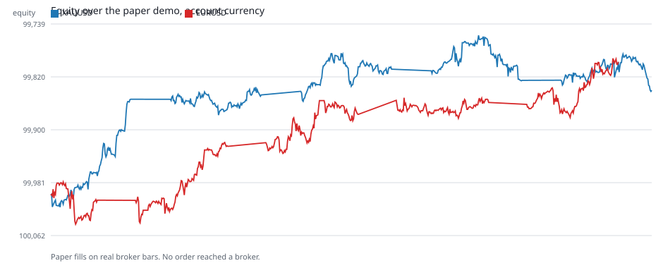
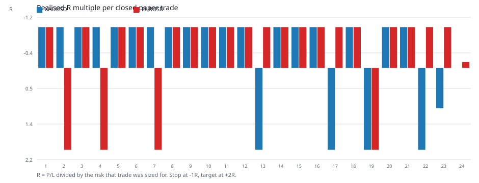
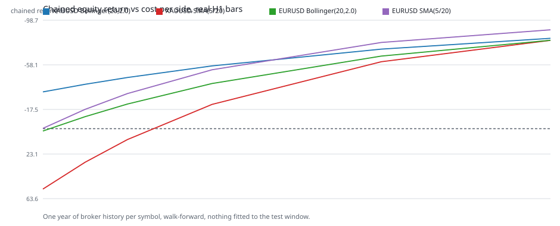
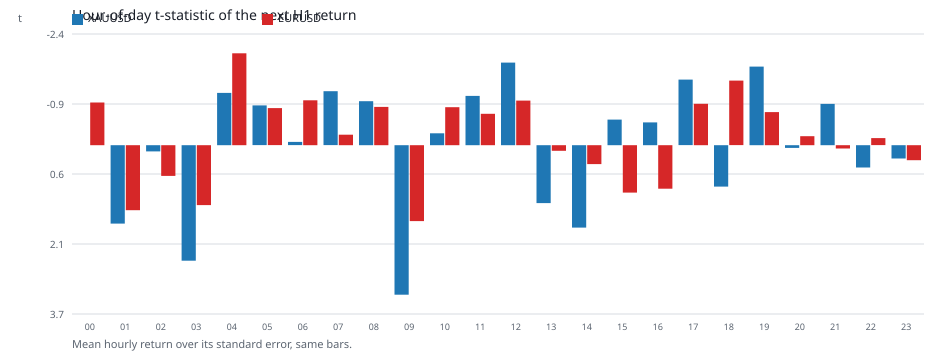

# Kết quả chạy demo trên dữ liệu thật

Tiếng Nga là bản gốc. English: [DEMO_RESULTS.en.md](DEMO_RESULTS.en.md) · Русский:
[DEMO_RESULTS.md](DEMO_RESULTS.md).

Phiên chạy thực hiện ngày 2026-11-01 trên máy có cài MetaTrader 5 (build 6296), tài khoản demo
`114929502` tại `MetaQuotes-Demo`, tiền tệ tài khoản USD, vốn mở đầu 100.000. Nến là nến H1 thật của
nhà môi giới, tải từ terminal qua `copy_rates_range`; không một bước nào của phiên chạy chứa lệnh
giao dịch, và mọi bản ghi nhật ký đều mang `broker_order_sent: false`.

## Đã chạy những gì

```powershell
PYTHONPATH=src python scripts/run_mt5_agent.py run `
  --policy agent_data/demo_eurusd_real.yaml --source live --live-bars 600 `
  --balance 100000 --currency USD --db agent_data/demo_eurusd.db --language vi --execution auto --verbose
PYTHONPATH=src python scripts/run_mt5_agent.py run `
  --policy agent_data/demo_xauusd_real.yaml --source live --live-bars 600 `
  --balance 100000 --currency USD --db agent_data/demo_xauusd.db --language vi --execution auto --verbose
```

Chính sách nằm trong `agent_data/` (không thuộc repository): `risk_per_trade_fraction: 0.0002`,
`min_risk_reward: 1.5`, `max_open_positions: 1`, `execution_mode: auto`, `require_demo: true`, cùng
`expected_login` / `expected_server` được ghim. Thông số công cụ đọc từ terminal: EURUSD — point
0.00001, giá trị tick 1.0, khối lượng 0.01/0.01/500; XAUUSD — point 0.01, giá trị tick 0.1, khối
lượng 0.01/0.01/100.

## Kết quả phiên chạy

| Công cụ | Số chu kỳ | Lệnh đã đóng | Lệnh thắng | Tỷ lệ thắng | P/L thực hiện | Vốn | Vốn min / max | Chuỗi nhật ký |
|---|---|---|---|---|---|---|---|---|
| XAUUSD | 540 | 23 | 5 | 0,217 | −159,96 | 100.000 → 99.840,04 | 99.756,24 / 100.018,21 | `valid: true`, 1104 sự kiện |
| EURUSD | 540 | 24 | 4 | 0,167 | −203,39 | 100.000 → 99.796,61 | 99.791,41 / 100.044,31 | `valid: true` |

Không chu kỳ nào gửi lệnh tới nhà môi giới; 501 (XAUUSD) và 475 (EURUSD) chu kỳ bị chặn bởi giới hạn
một vị thế mở, 11 và 19 chu kỳ vì không có tín hiệu, 5 và 22 chu kỳ vì ngoài khung giờ giao dịch.





## Vì sao kết quả lại như vậy

Stop là 2 × ATR và target là 2R. Với bước ngẫu nhiên không trôi, xác suất đạt +2R trước khi chạm −1R
bằng đúng 1/3, và kỳ vọng trước chi phí bằng 0. Tỷ lệ thắng quan sát được (0,217 và 0,167) **thấp
hơn** ngưỡng đó, nên lỗ trên mỗi lệnh xuất hiện dù rủi ro rất nhỏ: −6,95 USD mỗi lệnh với vàng và
−8,47 USD với EURUSD.

Một phép đo riêng trên một năm nến thật của cùng nhà môi giới xác nhận điều này: tự tương quan bậc
một của lợi nhuận theo giờ là âm (XAUUSD −0,019, EURUSD −0,0067), nghĩa là sau một chuỗi nến tăng thì
nến kế tiếp có xu hướng hồi lại, trong khi SMA(5/20) vào lệnh đúng lúc đường nhanh đã nằm trên đường
chậm. Với 23 và 24 lệnh, các con số chưa chứng minh chiến lược thua lỗ (t = −1,57 và −1,95), nhưng
cũng không cho phép gọi nó là có lãi.

## Nghiên cứu lợi thế trên nến thật

`scripts/render_demo_evidence.py` tính lại cả hai họ chiến lược trên cùng các nến thật, không bao giờ
mềm tham số theo cửa sổ đang kiểm thử, và lặp lại phép quét ở nhiều mức chi phí mỗi chiều:



| Công cụ | Chi phí mỗi chiều | Bollinger(20, 2.0) | SMA(5/20) |
|---|---|---|---|
| XAUUSD | 0 bps | −33,5% (219 lệnh) | +54,9% (344) |
| XAUUSD | 5 bps | −46,6% | +9,9% |
| XAUUSD | 20 bps | −72,4% | −60,9% |
| EURUSD | 0 bps | +2,1% (275 lệnh) | −0,3% (382) |
| EURUSD | 5 bps | −22,4% | −32,0% |
| EURUSD | 20 bps | −66,1% | −78,4% |

Chi phí bằng 0 là trường hợp không tồn tại về mặt vật lý, không phải cận trên: nó cho thấy cả hai họ
đều không có biên an toàn. Tín hiệu đo được duy nhất là phân bố theo giờ:



Vàng cho t = +3,25 lúc 09 UTC và +2,51 lúc 03 UTC trên 5742 quan sát; ở EURUSD giờ dương lớn nhất là
+1,65, còn giờ lệch mạnh nhất lại âm: t = −2,00 lúc 04 UTC. Đây là
giả thuyết, chưa phải lợi thế: sau khi hiệu chỉnh cho 24 phép so sánh, giờ vàng chỉ còn ý nghĩa ranh
giới, và nó phải được kiểm tra trên một giai đoạn riêng.

## Đối chiếu với thư mục làm việc song song

`C:\Users\Administrator\.zcode\workspace\default` chứa công trình độc lập cùng ý tưởng dùng nến công
khai của Binance (không phải MT5): walk-forward 12 fold, 32 cấu hình chiến lược vàng, và các phiên
"live" ảo. Kết luận của họ trùng với chúng ta: các họ theo xu hướng đều âm, mẫu thắng in-sample đổ vỡ
out-of-sample (PF 1,4 → 0,48), vàng có tính hồi quy (lag-1 của họ −0,015 so với −0,019 của ta trên nến
nhà môi giới), và họ duy nhất sống sót ở đó — Bollinger(20, 2.0) trên EURUSDT, +7,1% — **không tái
lập** trên nến thật của nhà môi giới (−22,4% chỉ với 5 bps mỗi chiều). Số dư "live" của họ:
1000 → 1004, 1000 → 996, 996,70, 998,33, +0,08, −0,57.

## Phiên chạy này chứng minh gì và không chứng minh gì

Đã chứng minh: chuỗi "nến thật nhà môi giới → cổng chính sách → tính khối lượng → khớp lệnh giấy →
nhật ký liên kết hash" hoạt động và tái lập được bằng lệnh ở trên; rủi ro mỗi lệnh đúng cam kết (mỗi
stop −18…−20 USD so với ngân sách 20 USD); không có lệnh nào tới nhà môi giới.

Chưa chứng minh: khớp lệnh thật tại nhà môi giới. Khi chạy, thị trường đóng cửa cuối tuần (tick
EURUSD cuối đã quá tuổi cho phép 20,4 giờ, XAGUSD không có tick, US500 báo `trade_mode = 0`), nên
đường `scripts/run_mt5_demo_trading.py` + `scripts/mt5_demo_bridge.py` + EA bị cổng `QUOTE_STALE`
chặn — đó là hành vi đúng thiết kế, không phải kết quả khớp lệnh. EA cũng chưa gắn lên đồ thị và
`Config/common.ini` chưa có allowlist, nên xác nhận khớp lệnh phía nhà môi giới vẫn là
PENDING EXTERNAL.
