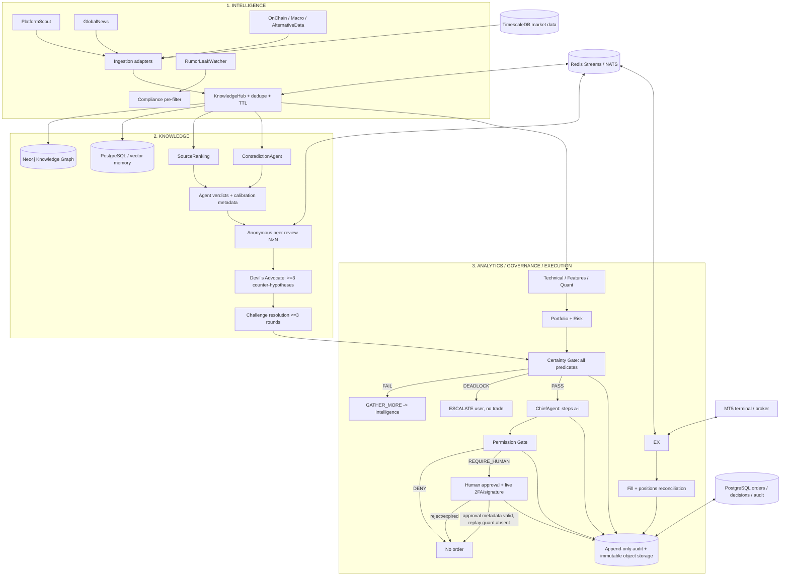

# Архитектура и sequence

## Реализация в текущем каркасе

- Реализованы Python policy gates, `evaluate_signal_bundle`, HTTP bridge-key authentication, Redis Streams helper functions and hash-chain verification.
- `PermissionRequest` привязывается к сигналу, exact `ChiefReasoning` hash, рассчитанному consensus и сводкам проверенных источников; расхождение блокирует переход к human gate.
- Human review packet содержит все peer reviews, dissenting opinions, полный challenge ledger, ChiefReasoning, source reports, risk snapshot и tail-risk fields.
- API endpoint проверки authorization отключён (HTTP 423), пока отсутствуют persistent server-side permission state и настоящий криптографический 2FA/signature verifier.
- Подключение ingestion agents, permanent DB repository, actual worker service, TOTP/signature provider, order dispatcher and MQL5 compilation are not yet implemented/verified.
- Execution-related endpoints intentionally cannot publish, fetch or send an order command. The diagram includes the future production boundary, not an enabled path.

## Invariants

- Любое решение вычисляется как conjunction обязательных условий, не по большинству голосов.
- `PASS` у CertaintyGate означает только передачу на ChiefAgent; `CONFIRM` ChiefAgent означает только разрешение перейти к PermissionGate.
- PermissionGate возвращает `REQUIRE_HUMAN`; без durable permission state и persistent replay/idempotency store approval остаётся метаданными и завершается `DENY`. Одноразовое разрешение пока не реализовано.
- Исполнительный мост перепроверяет TTL, client_order_id, slippage, SL/TP, состояние счёта и текущие позиции непосредственно перед операцией.
- При неопределённом результате вызова брокера не выполняется слепой retry; запускается reconcile.

## Область MVP

1. Первая итерация: данные read-only, demo/paper, 3–4 агента, ручной approve на каждый ордер.
2. Никакого live, пока не проверены контракты, брокерские ограничения, отказоустойчивость, forward-тесты и юридические условия.
3. Перенос bridge на отдельный Windows VPS; агенты/очереди/БД — Linux. Слушать localhost, внешний доступ закрыть firewall/IP allowlist.
