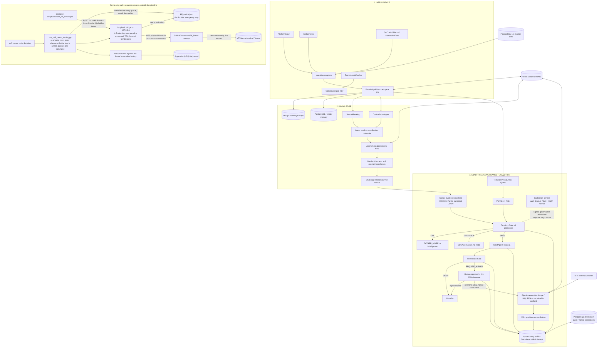

# Архитектура и sequence

## Реализация в текущем каркасе

- Реализованы Python policy gates и `evaluate_signal_bundle`; каждый verdict привязывается к каноническому hash точного `signal_input`. Внутренний CLI `scripts/evaluate_signal_bundle.py` запускает полный детерминированный путь и не принимает переданное клиентом human approval.
- Пакет доказательств принимается только в подписанном HMAC-SHA256 конверте (`MT5_EVIDENCE_HMAC_KEY`, ожидаемый issuer `MT5_EVIDENCE_ISSUER`). Подпись покрывает канонический JSON без `user_decision`, поэтому любая правка после подписания даёт `EVIDENCE_*` blocker и `GATHER_MORE`. Конверт не одноразовый: воспроизведение ограничено `min(max_age_seconds, ttl_seconds)` (по умолчанию 300 с, потолок конверта 3600 с), поэтому идемпотентность должна обеспечиваться нижележащими nonce/permission stores, а не самим конвертом.
- Peer reviews, verdicts, challenge ledger и ChiefReasoning принимаются только с отдельной `review_attestation` в домене `review` (`MT5_REVIEW_HMAC_KEY`, issuer `MT5_REVIEW_ISSUER`), покрывающей `{signal_id, verdicts, peer_reviews, challenge_records, chief_reasoning}`. Ingress-ключ не может подписать review-домен, поэтому компрометация ingress не позволяет сфабриковать «независимые» ревью или Chief CONFIRM; API проверяет атестацию на `/v1/certainty/evaluate` и `/v1/chief/review` (последний оценивает только attested `chief_reasoning`, а не плоский payload), а pipeline/CLI — на всём пути.
- Калибровочные метрики (dissent rate, false-certainty rate, sample size) берутся только из отдельной governance-аттестации, подписанной другим ключом (`MT5_GOVERNANCE_HMAC_KEY`) и другим issuer (`MT5_GOVERNANCE_ISSUER`, по умолчанию `calibration-service`). Значения из самого bundle для гейта не используются.
- `mandatory_agents` и `compliance_agent_id` принадлежат policy-конфигу; `compliance_status` вычисляется из verdict `ComplianceAgent`, а не принимается из bundle.
- `PermissionRequest` привязывается к сигналу (instrument, direction), exact `ChiefReasoning` hash, рассчитанному consensus и сводкам проверенных источников; расхождение блокирует переход к human gate.
- Решение человека принимается только как отдельный envelope в домене `operator` (`MT5_OPERATOR_HMAC_KEY` + отдельные issuer/ключ), привязанный к `signal_id`, `ChiefReasoning` hash, каноническому hash точного `permission_request` и (на persisted-risk пути) каноническому hash терминального risk snapshot, который проверил риск-гейт. Evidence-подписант не может одобрить сделку: evidence-envelope исключает `user_decision`, а без operator-конфигурации approval блокируется. Tombstone в `authorization_permissions` привязан к серверному хэшу параметров ордера (signal/instrument/direction/size/entry/SL/TP/mode), а не к клиентскому `permission_id`, поэтому переименование разрешения не даёт повторного допуска.
- API не доверяет агрегатам клиента: `reviewer_count`, consensus и `open_challenges` пересчитываются из raw peer reviews/challenge ledger; `/v1/permission/check` отключён (HTTP 423), а `/v1/risk/permission/check` использует только persisted kill-switch и MT5 snapshot.
- Persisted risk snapshot сверяется с заказом: symbol и request-binding hash; риск считается по худшей из reviewed и reference цены (`max` для BUY, `min` для SELL) и делится на `min(account_equity, account_balance)`, а не только по `expected_price` и одной equity. Идентичность счёта обязательна (`account_login` — целое `>= 1`, `account_server` — непустая строка), а policy может закрепить ожидаемые значения, и тогда несовпадение даёт DENY. Позиции должны быть согласованы: `position_symbols` длиной ровно `open_positions`, `correlated_open_positions <= open_positions`, положительный `open_stop_risk_fraction` при нуле позиций запрещён, и каждая открытая позиция требует свежего тика своего символа (иначе `OPEN_POSITION_STOP_RISK_UNKNOWN`, а не занижение нулём). Slippage больше 10% дистанции до стопа, reference price за TP/SL, несовпадение `risk_value`/`risk_fraction` (допуск 1%), daily loss и drawdown не из equity-баз, peak ниже day-start, day-start ниже или выше `balance − daily_pnl` (допуск 1%) или нечисловые (`NaN`/`Infinity`) значения дают DENY. `open_stop_risk_fraction` обязателен, должен быть JSON-числом `[0, 1]` и считается от текущей цены до стопа (позиция в безубытке даёт ноль); проспективные лимиты складывают его с реализованными daily-loss/drawdown и риском новой сделки. Reward/risk применяется безусловно (включая flat-снимок), пересчитывается по худшей цене входа и сравнивается с `min_expected_rr`. Отсутствие tick-спецификации, `reference_price`, `account_balance` или `daily_pnl` также даёт DENY.
- Human review packet содержит все peer reviews, dissenting opinions, полный challenge ledger, ChiefReasoning, source reports, risk snapshot и tail-risk fields. В persisted-risk пути пакет несёт именно терминальный снимок, который проверил gate, вместе с `risk_snapshot_validation` и `risk_reconciliation` и явным `risk_snapshot_source`; клиентская сводка используется только в offline-режиме и помечается как `client_supplied_unverified`. Пакет никогда не авторизует исполнение.
- Одно подтверждение ограничено дважды: одноразовый nonce на оператора и отдельный insert-only tombstone (`authorization_permissions`, миграция 006), ключ которого — серверный хэш параметров ордера, а не клиентский `permission_id`. Переименование разрешения или повтор nonce не проходит; без durable permission store authorization не выполняется.
- API endpoint проверки authorization отключён (HTTP 423), пока отсутствуют persistent server-side permission state и настоящий криптографический 2FA/signature verifier.
- PostgreSQL persistence stores immutable market history, forecast labels, risk/kill-switch snapshots and full decision/audit runs. The Redis worker script persists valid events before ACK; parse-invalid/poison events are dead-lettered to `cc:dead-letter:v1` on first delivery and only then ACKed, while handler failures stay pending and are reclaimed (`XAUTOCLAIM`) on each loop, so they are retried up to `max_attempts=3` deliveries before being dead-lettered. A production-managed worker service is not deployed. The provider-backed anonymized peer-review and challenge-resolution runner exists and is unit-tested, but it has not been exercised against real independent provider endpoints and its confidence values remain uncalibrated. Trusted source ingestion/registry, historical calibration/health datasets and a TOTP/signature provider remain unimplemented. The policy pipeline has no broker order dispatcher and no endpoint that can fetch an order command. The only path that can reach a broker at all is a separate demo-only loopback bridge (`scripts/mt5_demo_bridge.py`, `scripts/run_mt5_demo_trading.py` and the `CriticalConsensusEA_Demo` advisor, documented in `docs/MT5_AGENT*.md`): it is outside the permission pipeline, refuses any account that is not a demo, and takes exactly one write — the authenticated kill-switch POST that flips a durable `kill_switch.json` both the runner and the advisor re-read on every check (arming needs the bridge key, releasing needs a second admin secret) — and its status as of 2026-10-31 is compile/install and terminal allowlist **PROVEN**, a real chart `WebRequest` and a broker-filled demo order **NOT PROVEN** (the market was closed on 2026-10-31, so every cycle blocked on `QUOTE_STALE`). Forward testing of that transport is not possible in the Strategy Tester: `WebRequest` does not execute there — an MT5 limitation, not a gap in this code.
- Execution-related endpoints intentionally cannot publish, fetch or send an order command. The diagram includes the future production boundary, not an enabled path. `/v1/execution/next` on the policy API answers `204 No Content` and `/v1/execution/submit`, `/v1/permission/check` and `/v1/authorization/check` answer HTTP 423; the demo bridge happens to expose the same two GET paths, but it is a different process bound to `127.0.0.1`, it is not the policy API and no policy-API decision feeds it.

## Invariants

- Любое решение вычисляется как conjunction обязательных условий, не по большинству голосов.
- `PASS` у CertaintyGate означает только передачу на ChiefAgent; `CONFIRM` ChiefAgent означает только разрешение перейти к PermissionGate.
- PermissionGate не выдаёт исполнение: он либо возвращает `REQUIRE_HUMAN`, либо `DENY`, и ни один результат не делает `trade_allowed=True`; authorization формирует одноразовое разрешение, но не создаёт ордер. `/v1/execution/next` отвечает `204 No Content`, а `/v1/execution/submit`, `/v1/permission/check` и `/v1/authorization/check` — HTTP 423.
- Каждый `nonce` авторизации расходуется ровно один раз через `authorization_store` (`InMemoryNonceStore` или `PostgresNonceStore` с insert-only tombstones: атомарный INSERT, без обновлений/удалений в обработке запроса; ручная очистка только после `expires_at` и retention-окна); повтор того же nonce получает `AUTHORIZATION_NONCE_REPLAYED`. Без store authorization не выдаётся.
- Исполнительный мост перепроверяет TTL, client_order_id, slippage, SL/TP, состояние счёта и текущие позиции непосредственно перед операцией. В каркасе это делает только demo-путь: `run_mt5_demo_trading.py` перед постановкой команды заново прогоняет все гейты и после исполнения сверяется с историей сделок самого брокера (неопределённый результат не ретраится), а EA принимает команду лишь при `mode: demo`, `decision: APPROVE`, явном `user_approved`, `ACCOUNT_TRADE_MODE_DEMO`, разрешённом алгоритмическом трейдинге, целом `expires_at_epoch` не далее `MaxCommandTtlSeconds` от `TimeGMT()`, и пишет два tombstone — по `command_id` и по `client_order_id`. Мост pipeline не реализован.
- При неопределённом результате вызова брокера не выполняется слепой retry; запускается reconcile.

## Область MVP

1. Первая итерация: данные только на чтение (без торговых вызовов), demo/paper, 3–4 агента, ручной approve на каждый ордер.
2. Никакого live, пока не проверены контракты, брокерские ограничения, отказоустойчивость, forward-тесты и юридические условия.
3. Перенос bridge на отдельный Windows VPS; агенты/очереди/БД — Linux. Слушать localhost, внешний доступ закрыть firewall/IP allowlist.
