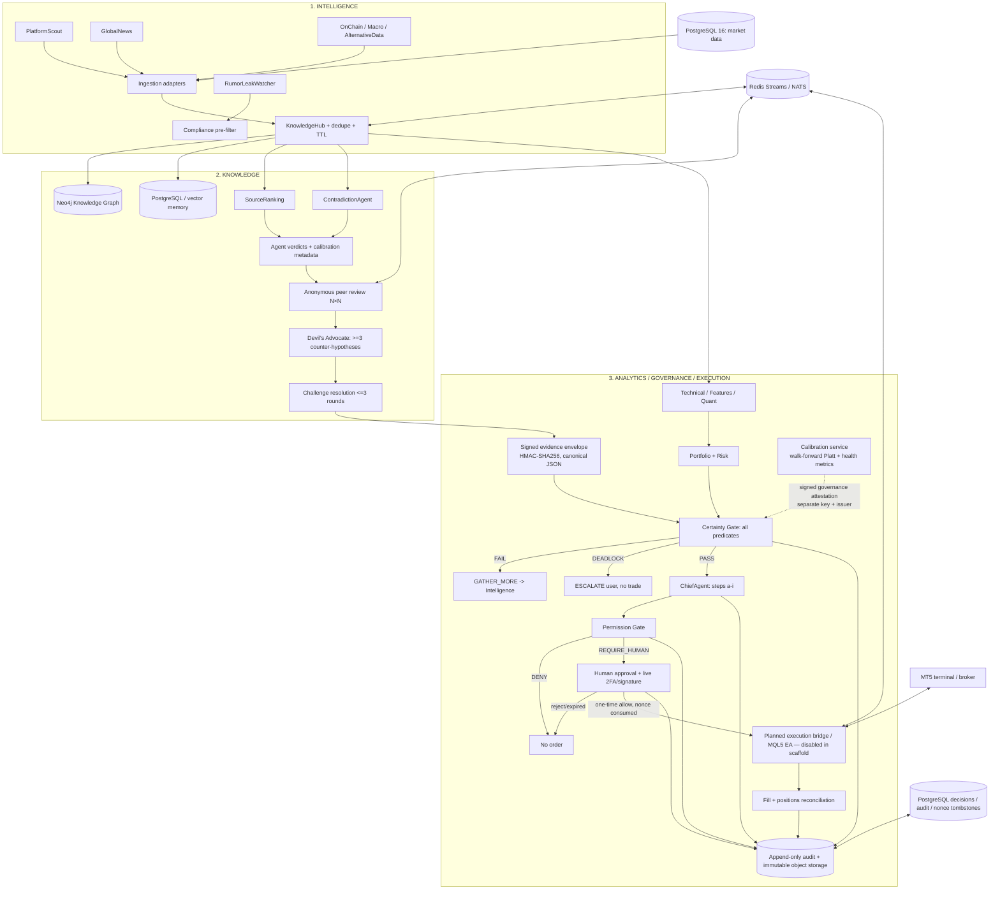

# Архитектура и sequence

## Реализация в текущем каркасе

- Реализованы Python policy gates и `evaluate_signal_bundle`; каждый verdict привязывается к каноническому hash точного `signal_input`. Внутренний CLI `scripts/evaluate_signal_bundle.py` запускает полный детерминированный путь и не принимает переданное клиентом human approval.
- Пакет доказательств принимается только в подписанном HMAC-SHA256 конверте (`MT5_EVIDENCE_HMAC_KEY`, ожидаемый issuer `MT5_EVIDENCE_ISSUER`). Подпись покрывает канонический JSON без `user_decision`, поэтому любая правка после подписания даёт `EVIDENCE_*` blocker и `GATHER_MORE`. Конверт не одноразовый: воспроизведение ограничено только `issued_at` + `ttl_seconds` (по умолчанию 300 с, потолок 3600 с), поэтому идемпотентность должна обеспечиваться нижележащими nonce/permission stores, а не самим конвертом.
- Калибровочные метрики (dissent rate, false-certainty rate, sample size) берутся только из отдельной governance-аттестации, подписанной другим ключом (`MT5_GOVERNANCE_HMAC_KEY`) и другим issuer (`MT5_GOVERNANCE_ISSUER`, по умолчанию `calibration-service`). Значения из самого bundle для гейта не используются.
- `mandatory_agents` и `compliance_agent_id` принадлежат policy-конфигу; `compliance_status` вычисляется из verdict `ComplianceAgent`, а не принимается из bundle.
- `PermissionRequest` привязывается к сигналу (instrument, direction), exact `ChiefReasoning` hash, рассчитанному consensus и сводкам проверенных источников; расхождение блокирует переход к human gate.
- Решение человека принимается только как отдельный envelope в домене `operator` (`MT5_OPERATOR_HMAC_KEY` + отдельные issuer/ключ), привязанный к `signal_id`, `ChiefReasoning` hash и каноническому hash точного `permission_request`. Evidence-подписант не может одобрить сделку: evidence-envelope исключает `user_decision`, а без operator-конфигурации approval блокируется.
- API не доверяет агрегатам клиента: `reviewer_count`, consensus и `open_challenges` пересчитываются из raw peer reviews/challenge ledger; `/v1/permission/check` отключён (HTTP 423), а `/v1/risk/permission/check` использует только persisted kill-switch и MT5 snapshot.
- Persisted risk snapshot сверяется с заказом: symbol и request-binding hash; риск считается по худшей из reviewed и reference цены (`max` для BUY, `min` для SELL), а не только по `expected_price`. Slippage больше 10% дистанции до стопа, reference price за TP/SL, несовпадение `risk_value`/`risk_fraction` (допуск 1%), daily loss и drawdown не из equity-баз, peak ниже day-start или day-start ниже `balance − daily_pnl` (допуск 1%) дают DENY. Reward/risk дополнительно пересчитывается по худшей цене входа и сравнивается с `min_expected_rr`. Отсутствие tick-спецификации, `reference_price`, `account_balance` или `daily_pnl` также даёт DENY.
- Human review packet содержит все peer reviews, dissenting opinions, полный challenge ledger, ChiefReasoning, source reports, risk snapshot и tail-risk fields. Risk snapshot в пакете может быть клиентским, если проверка шла без `require_persisted_risk`; доверенным он считается только в persisted-risk пути, где собран терминалом и сверен с заказом. Пакет никогда не авторизует исполнение.
- API endpoint проверки authorization отключён (HTTP 423), пока отсутствуют persistent server-side permission state и настоящий криптографический 2FA/signature verifier.
- PostgreSQL persistence stores immutable market history, forecast labels, risk/kill-switch snapshots and full decision/audit runs. The Redis worker script persists valid events before ACK (poison events are dead-lettered to `cc:dead-letter:v1` before ACK after `max_attempts=3` delivery attempts, and handler failures stay pending), but a production-managed worker service is not deployed. The provider-backed anonymized peer-review and challenge-resolution runner exists and is unit-tested, but it has not been exercised against real independent provider endpoints and its confidence values remain uncalibrated. Trusted source ingestion/registry, historical calibration/health datasets, TOTP/signature provider, broker order dispatcher and MetaEditor/MT5 forward testing remain unimplemented or unverified.
- Execution-related endpoints intentionally cannot publish, fetch or send an order command. The diagram includes the future production boundary, not an enabled path.

## Invariants

- Любое решение вычисляется как conjunction обязательных условий, не по большинству голосов.
- `PASS` у CertaintyGate означает только передачу на ChiefAgent; `CONFIRM` ChiefAgent означает только разрешение перейти к PermissionGate.
- PermissionGate не выдаёт исполнение: он либо возвращает `REQUIRE_HUMAN`, либо `DENY`, и ни один результат не делает `trade_allowed=True`; authorization формирует одноразовое разрешение, но не создаёт ордер. `/v1/execution/next` отвечает `204 No Content`, а `/v1/execution/submit`, `/v1/permission/check` и `/v1/authorization/check` — HTTP 423.
- Каждый `nonce` авторизации расходуется ровно один раз через `authorization_store` (`InMemoryNonceStore` или `PostgresNonceStore` с insert-only tombstones: атомарный INSERT, без обновлений/удалений в обработке запроса; ручная очистка только после `expires_at` и retention-окна); повтор того же nonce получает `AUTHORIZATION_NONCE_REPLAYED`. Без store authorization не выдаётся.
- Исполнительный мост перепроверяет TTL, client_order_id, slippage, SL/TP, состояние счёта и текущие позиции непосредственно перед операцией.
- При неопределённом результате вызова брокера не выполняется слепой retry; запускается reconcile.

## Область MVP

1. Первая итерация: данные read-only, demo/paper, 3–4 агента, ручной approve на каждый ордер.
2. Никакого live, пока не проверены контракты, брокерские ограничения, отказоустойчивость, forward-тесты и юридические условия.
3. Перенос bridge на отдельный Windows VPS; агенты/очереди/БД — Linux. Слушать localhost, внешний доступ закрыть firewall/IP allowlist.
